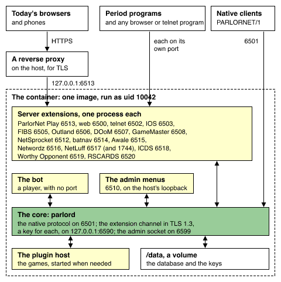

# ParlorNet

ParlorNet is a server for turn-based games such as Reversi, Backgammon and Checkers. It speaks the protocols of old game servers, so you can play on it with the original game programs. These programs were first released about 25 to 50 years ago for the computers of their day. On a classic Mac, for example, you can play with Reversi The Eclipse, MacFIBS or GameMaster. For a few computers, ParlorNet has its own client program that plays the complete set of games and works with any ParlorNet server. ParlorNet for the Apple IIe, IIgs and Commodore 64 is one. On classic Macs, ParlorNet's rulebooks for GameMaster add the games that GameMaster lacks. If your computer has no such program, you can play in a web browser or a telnet program. ParlorNet Play lets you play in the browser of a current computer or phone.

To find a program for your computer, open the Clients page at http://docs.parlornet.org/. It lists the programs that play each game on each kind of computer. Each program has its own page that tells you where to get it, how to set it up and how to sign in.

Anyone can run a ParlorNet server for a club, a festival, a group of friends or the open internet. A ParlorNet server is called a parlor, and one parlor plays every game. The [Run your own parlor](#run-your-own-parlor) section below starts one with a single `docker run`. For a server that stays up, [deploy/README.md](deploy/README.md) installs the same image with tighter limits. The docs site has both on one page, [Run a server](http://docs.parlornet.org/running.html).

ParlorNet is free software under the MIT license. Its source is at https://github.com/eric-cgn/parlornet. If you want to contribute, read [CONTRIBUTING.md](CONTRIBUTING.md) first. It also has notes on trademarks and on the terms of other programs.

## Games

A parlor plays ten games: Reversi, Backgammon, Grid Words, Cannon Fire, Dots and Boxes, Five in a Row, Mancala, Checkers, Naval Combat and Rummy Tile Classic. Each one is ParlorNet's own implementation of public rules, under a generic or original name. The games were built in this order, and menus and the lobby list them the same way. Every parlor's web site describes them on its Games page, `/games.htm`.

## How ParlorNet is built

A parlor is a set of separate programs in one Docker container. Its daemon is `parlord`, and its protocol announces itself with the banner `PARLORNET/1`. [docs/architecture.md](docs/architecture.md) describes how the parts fit together, and [docs/auth-federation.md](docs/auth-federation.md) describes the design for federation between parlors.

- **The core** is a Python server that keeps the accounts, the lobby and the tables, and handles turns. It knows no game rules.
- **Each game is a plugin** that runs outside the core's process. The Python plugins share one plugin host, and a plugin in another language runs in a process of its own. Each one starts when a game needs it and stops when it is idle. [docs/plugins.md](docs/plugins.md) describes the interface. [docs/games-howto.md](docs/games-howto.md) explains how to add a game with its plugin, type spec, web and telnet module and tests. The type specs are in [docs/types/](docs/types/).
- **The protocol**, PARLORNET/1, is line-based ASCII and suits clients that poll. [docs/protocol.md](docs/protocol.md) is the reference. If you want to write a client of your own, [docs/pnp.md](docs/pnp.md) is the guide, with sample sessions for every game.
- **Server extensions** are separate programs that run beside the core. Each one speaks a single protocol to the players' programs and passes their moves on to the core. There is one each for the web site, ParlorNet Play, telnet, IOS, FIBS, Outland, DOoM, GameMaster, NetSprocket, batnav, Awale, Networdz, NetLuff, ICDS, Worthy Opponent and RSCARDS. They are in the `adapters/` package, and ParlorNet Play, the browser client, is in `adapters/play/`. Each extension tells the core which protocol it speaks, and the core lists them with `PRL`. [docs/adapters.md](docs/adapters.md) describes the extensions, and [docs/protocols.md](docs/protocols.md) describes each protocol and its port.
- **The players' programs** run on the players' own computers. [docs/frontends.md](docs/frontends.md) and the docs site's Clients page describe them.
- **The bot** can play every game, and anyone can invite it to a table. It is a client of the core, in `bot/`, and [docs/bot.md](docs/bot.md) describes it.
- **ParlorNet's classic Mac software** is built and released in its own repositories. [eric-cgn/parlornet-gamemaster](https://github.com/eric-cgn/parlornet-gamemaster) has ParlorNet's rulebooks for GameMaster and their installer. [eric-cgn/parlornet-eclipse-fix](https://github.com/eric-cgn/parlornet-eclipse-fix) has Eclipse 68k Fix, the patcher for Reversi The Eclipse on 68k Macs. The docs site serves their release files over plain HTTP, and `docsite/downloads.json` pins each file by its SHA-256.
- **The docs site** is built with `python3 tools/build_docs.py`, which writes it to `build/docs-site`. On every push to `main`, `.github/workflows/docs.yml` builds it and publishes it to GitHub Pages at http://docs.parlornet.org/. [docs/site.md](docs/site.md) describes it.



## Run your own parlor

A parlor runs in one Docker container. The `docker run` below is enough to try ParlorNet or to run a small parlor. For a server that stays up, [deploy/README.md](deploy/README.md) installs the same image with a memory limit and a read-only root file system, and it keeps the admin menus and ParlorNet Play on the host's loopback address.

Get the source from https://github.com/eric-cgn/parlornet. Then build the image from its top directory and start it:

```sh
docker build -t parlornet .
docker run -d --name parlornet --restart unless-stopped \
    -p 6500-6505:6500-6505 -p 6506:4000 -p 6507-6508:6507-6508 -p 6512:6512 -p 6514:6514 -p 6515-6517:6515-6517 -p 1744:6517 -p 6518:6518 -p 6519:6519 -p 6520:6520 \
    -p 127.0.0.1:6510:6510 -v parlornet:/data parlornet
docker logs parlornet
```

The first time the parlor starts, the log says that it is not set up yet and gives a one-time setup password. To set it up, open the admin menus with `telnet 127.0.0.1 6510` on the same machine. From another machine, open an SSH tunnel with `ssh -L 6510:127.0.0.1:6510 you@host` and then run the same telnet command. The admin menus ask for the setup password and then for a permanent admin password. After that you can set the server's name, the welcome message, the sign-in method, email, the games, the server extensions, the accounts and the tables.

Port 6510 is the admin port. It always asks for the admin password, but publish it only on the host's loopback address, as the command above does.

### Ports

Players connect to these ports:

| Port | Used by |
|---|---|
| 6500 | web browsers |
| 6501 | programs that speak ParlorNet's own protocol |
| 6502 | telnet programs |
| 6503 | IOS clients for Reversi |
| 6505 | FIBS clients for Backgammon |
| 6506 | the Outland Gateway (the container listens on 4000) |
| 6507 | DOoM clients for Grid Words |
| 6508 | GameMaster |
| 6512 | NetBoxes, over NetSprocket |
| 6513 | ParlorNet Play |
| 6514 | the batnav clients |
| 6515 | Awale, over IRC |
| 6516 | Networdz |
| 6517 | NetLuff, published as 1744 as well |
| 6518 | xcheckers, over ICDS |
| 6519 | Worthy Opponent, dialed by modem |
| 6520 | GEnie's RSCARDS front ends, through a WiFi modem or a serial bridge |

NetLuff always connects to port 1744, so publish 6517 as 1744 too, as the command above does.

ParlorNet Play, the client for current browsers and phones, is not in the command above. To try it, add `-p 6513:6513` and open `http://` your host `:6513/play/`. For a server that stays up, put it behind an HTTPS proxy as [deploy/README.md](deploy/README.md#parlornet-play-over-https) shows.

### Data and containment

The `/data` volume keeps the players, the tables and the settings. It also keeps the keys that the server extensions use to reach the core, in `/data/frontends`, which the first start creates.

The container runs as one unprivileged user (uid 10042) and needs no capabilities, so `--cap-drop ALL` works. The Containment part of [docs/security-design.md](docs/security-design.md#containment) describes two optional ways to separate the server extensions further.

### Signing up and signing in

By default, players sign up by choosing a password and then sign in with it. Signing up is a separate step. On the web site it is New account, at the telnet login it is `new`, on FIBS clients it is the name `guest`, and in an IOS client it is a new name in the login window. You choose the sign-in and sign-up methods in the admin menus, under Sign-in. [docs/accounts.md](docs/accounts.md) explains each method.

### A LAN, a club night or a festival

With sign-in set to `none`, players sign in with their name alone:

```sh
docker run -d --name parlornet --restart unless-stopped -e PARLOR_NAME=festival -e PARLOR_AUTH=none \
    -p 6500-6505:6500-6505 -p 6506:4000 -p 6507-6508:6507-6508 -p 6512:6512 -p 6514:6514 -p 6515-6517:6515-6517 -p 1744:6517 -p 6518:6518 -p 6519:6519 -p 6520:6520 \
    -p 127.0.0.1:6510:6510 -v parlornet:/data parlornet
```

### The open internet

On the open internet, players sign in with a password, and signing up checks their email address. For this, sign-in is `password` and sign-up is `email`. When a player signs up, the parlor mails them a temporary password that works for 24 hours. Their first sign-in with it asks them to choose a password of their own. An account that nobody signs into within a day is deleted.

The parlor therefore needs an SMTP relay. Any SMTP relay will do, as long as it gives the parlor an account that can send mail. You can set the relay in the admin menus, under Sign-in. You can also keep its settings out of the database, in a file that only the container's user can read (`chown 10042 settings.conf; chmod 400 settings.conf`):

```
email.smtp_host=smtp.example.org
email.smtp_port=587
email.smtp_user=parlor
email.smtp_password=...
email.from=ParlorNet <noreply@example.org>
```

The parlor always reaches the relay over TLS, with STARTTLS or with TLS on port 465. It checks the relay's certificate against `email.smtp_host`, so give the relay's name there, not its address.

```sh
docker run -d --name parlornet --restart unless-stopped -e PARLOR_NAME=games.example.org \
    -e PARLOR_AUTH=password -e PARLOR_SIGNUP=email \
    -v /etc/parlornet/settings.conf:/run/parlornet/settings.conf:ro \
    -p 6500-6505:6500-6505 -p 6506:4000 -p 6507-6508:6507-6508 -p 6512:6512 -p 6514:6514 -p 6515-6517:6515-6517 -p 1744:6517 -p 6518:6518 -p 6519:6519 -p 6520:6520 \
    -p 127.0.0.1:6510:6510 -v parlornet:/data parlornet
```

### Settings in the environment

These environment variables give a parlor its first settings. Once the admin menus set a value, the parlor uses the value in its database instead.

- `PARLOR_NAME` is the server's name.
- `PARLOR_AUTH` is the sign-in method, `none` or `password`.
- `PARLOR_SIGNUP` is the sign-up method, `none`, `password` or `email`. With `email`, signing up mails the player a temporary password. By default, sign-up is `none` when sign-in is `none`, and `password` when sign-in is `password`.
- `PARLOR_ADAPTERS` lists the server extensions to start, for example `web,telnet,admin`.
- `PARLOR_MOTD_FILE` is a file with the message of the day.
- `PARLOR_CONTRIBUTE_URL` is the address that `{contribute}` in the message of the day shows. By default it is this project's home. If it is empty, that line is left out.
- `PARLOR_DOCS_URL` is the docs site that the web pages link to. By default it is http://docs.parlornet.org/. If it is empty, the pages have no link to it.

`PARLOR_ADMIN=1` starts the admin menus even if they were turned off.

If you forget the admin password, clear it with this command and restart the container. The log then shows a new setup password.

```sh
docker exec parlornet python -m parlord.admin --db /data/parlord.db --reset-password
```

## Branches and releases

The version number is in `VERSION`. Changes go into the `dev` branch by pull request, and each one is squashed. `main` takes only merges from `dev`, and that is how a release is made.

Every pull request and every push to `main` runs the fast tests on Python 3.13 and builds the Docker image (`.github/workflows/ci.yml`). A pull request into `main` fails unless it comes from `dev`. Every push to `dev` runs the same tests and build on the new commit (`.github/workflows/dev.yml`).

`PARLOR_TESTS=fast python3 -m unittest discover -s tests` runs the fast tests, and `python3 -m unittest discover -s tests` runs them all. The slow tests play whole games through the server extensions and the bot, use real timers and run the long matrices. They run together with the fast tests every night and by hand on `dev` (`.github/workflows/slow.yml`), and before a release is tagged (`.github/workflows/release.yml`). `tests/speed.py` says which tests are slow and how they are marked.

There is no separate dev pre-release. The server ships as its source, so the `dev` branch is the dev build.

A push to `main` whose version has no release yet runs the release workflow (`.github/workflows/release.yml`). It runs the tests, builds the image, tags the commit `v<version>` and publishes a GitHub Release of the source. No image is published, because each parlor builds its own.
