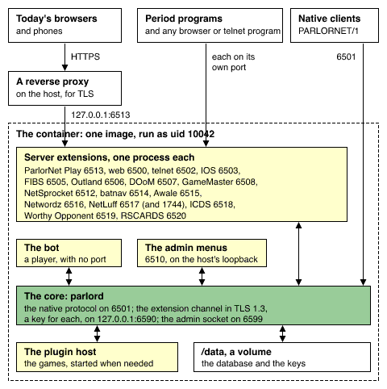

# Installing on a Docker host

This is how to install your own ParlorNet server on a Linux host with Docker. The main README's [Run your own parlor](../README.md#run-your-own-parlor) starts ParlorNet with a single `docker run`; the scripts here do the same job with tighter limits, for a server that stays up. Get the source from https://github.com/eric-cgn/parlornet, build the image (on the host, or elsewhere and load it on the host), copy the scripts across and run one of them as root.

```sh
docker build --platform linux/amd64 -t parlornet:1 .
sudo PARLOR_NAME=games.example.org PARLOR_AUTH=password PARLOR_SIGNUP=email sh deploy/install.sh parlornet:1
```

`install.sh` runs one container named `parlornet`. It runs as uid 10042 with every capability dropped, no new privileges, a read-only root file system, a 448 MB memory limit and its own Docker network. It publishes the players' ports (6500 to 6508, 6512, 6514 to 6517, which it also publishes as 1744, 6518, 6519 and 6520) and puts the admin menus and ParlorNet Play (6513) on the host's loopback address only. Players, tables and settings live in `/srv/parlornet` on the host, so a restart or an upgrade keeps them. Running the script again with a newer image replaces the container and keeps the data.



The script reads `PARLOR_NAME`, `PARLOR_AUTH`, `PARLOR_SIGNUP`, `PARLOR_WEB_HOSTS`, `PARLOR_WEB_URL`, `PARLOR_WEB_PROXIES`, `PARLOR_PLAY_URL`, `PARLOR_PLAY_PROXIES` and `PARLOR_PLAY_OPEN` from its environment; the comments at the top of the script explain each one. Settings you would rather keep out of the environment, such as the SMTP relay's password, go in `/etc/parlornet/settings.conf`. Make that file readable only by uid 10042 (`chown 10042 settings.conf; chmod 400 settings.conf`). The script mounts it into the container when it exists.

With `PARLOR_SIGNUP=email`, sign-up mails each new player a temporary password, so the server needs an SMTP relay ([The open internet](../README.md#the-open-internet) in the main README). The first sign-in with that password confirms the account and asks the player to choose a password of their own; an account nobody signs into within 24 hours is deleted.

**Upgrading from a version before mailed passwords.** Accounts used to be kept in another format, and that database is not carried over. When the server starts and finds a database in the earlier format, it renames it to `parlord.db.old-<date and time>` in the same directory and starts a new, empty one: players, tables and games in progress are gone, and the admin menus ask to be set up again, with a new setup password in `docker logs parlornet`. Settings given in the environment or in `/etc/parlornet/settings.conf` still apply. Delete the old file once you no longer need it.

Your host's firewall decides who can reach the ports. If you limit new connections per address, leave room for the web pages, which load a board image and a few small images each.

## ParlorNet Play over HTTPS

ParlorNet Play, the client for today's browsers, is its own server extension on port 6513. It speaks plain HTTP and expects a reverse proxy on the host to terminate TLS, so `install.sh` publishes it on `127.0.0.1:6513` only. Give the container its public address and the proxy's address, as the container sees it. For a proxy on the host that is the gateway of `install.sh`'s network, 172.30.4.1:

```sh
sudo PARLOR_PLAY_URL=https://games.example.org/play/ PARLOR_PLAY_PROXIES=172.30.4.1 sh deploy/install.sh parlornet:1
```

The same two settings can go in `/etc/parlornet/settings.conf` as `play.public_url` and `play.proxies`. With them, the WebSocket accepts only pages from that address, the session cookie is `Secure`, the player's own address is taken from `X-Forwarded-For`, and the web pages' `/play` answers with a 301 there. Without a proxy, `PARLOR_PLAY_OPEN=1` publishes 6513 on every address and players open `http://` your host `:6513/play/`.

An nginx server block for the proxy, with the certificate from Let's Encrypt (`certbot --nginx -d games.example.org` or `certbot certonly --webroot`), and port 80 sending `/play` to https:

```nginx
server {
    listen 443 ssl;
    server_name games.example.org;
    ssl_certificate     /etc/letsencrypt/live/games.example.org/fullchain.pem;
    ssl_certificate_key /etc/letsencrypt/live/games.example.org/privkey.pem;

    location /play/ {
        proxy_pass http://127.0.0.1:6513;
        proxy_http_version 1.1;
        proxy_set_header Upgrade $http_upgrade;
        proxy_set_header Connection "upgrade";
        proxy_set_header Host $host;
        proxy_set_header X-Forwarded-For $proxy_add_x_forwarded_for;
        proxy_set_header X-Forwarded-Proto $scheme;
        proxy_read_timeout 3600s;
        proxy_send_timeout 3600s;
    }
    location = /play { return 301 https://$host/play/; }
}

server {
    listen 80;
    server_name games.example.org;
    location /.well-known/acme-challenge/ { root /var/www/html; }
    location /play { return 301 https://$host/play/; }
}
```

## The web site on the usual ports

The web site itself is on port 6500, which players can keep using. To serve it at your name's own address as well, `https://games.example.org/` and `http://games.example.org/`, let the same proxy pass everything else to 6500. Pass it, don't redirect: a redirect to another port is not a page, so search engines index nothing, and port 80 must not send period browsers to https, which they cannot speak. Add this `location` to both server blocks above:

```nginx
    location / {
        proxy_pass http://127.0.0.1:6500;
        proxy_set_header Host $host;
        proxy_set_header X-Forwarded-For $proxy_add_x_forwarded_for;
        proxy_set_header X-Forwarded-Proto $scheme;
    }
```

Then tell the web extension about the proxy, the same way as for ParlorNet Play:

```sh
sudo PARLOR_WEB_URL=https://games.example.org/ PARLOR_WEB_PROXIES=172.30.4.1 sh deploy/install.sh parlornet:1
```

`PARLOR_WEB_PROXIES` (`web.proxies` in `/etc/parlornet/settings.conf`) lists the proxies' addresses or networks, separated by commas, as the container sees them. For a request from one of them, the web takes the visitor's own address from `X-Forwarded-For`, so the limits per address (sign-ups, wrong passwords, requests in progress) count each visitor and not the proxy, and it takes the scheme from `X-Forwarded-Proto`, so its redirects stay on https. A request from any other address is taken as it comes, and its forwarded headers are ignored. `PARLOR_WEB_URL` (`web.public_url`) is the site's own address. With it, every page answered without a query names its address there as canonical (a `Link: <...>; rel="canonical"` header), so the copies at port 6500, plain http and other names all count as one page. The site's address `/` is the welcome page itself, not a redirect to it.

Do not add `Strict-Transport-Security` on this name. Browsers would apply it to every port, including the 1997 pages on 6500, which are plain HTTP for the computers they serve. Certbot renews the certificate on its own timer.

## Administration

The admin menus listen on port 6510 on the host's loopback address. From another machine, open an SSH tunnel to the host and connect through it:

```sh
ssh -L 6510:127.0.0.1:6510 you@your-host
telnet 127.0.0.1 6510
```

Until you set an admin password, every start prints a one-time setup password in `docker logs parlornet`.

## More separation

`install-split.sh` is an opt-in alternative that runs each server process in its own container, each under its own uid and holding only its own key. It uses the same image and the same ports. docs/security-design.md (Containment) explains the trade-offs, and the comments at the top of the script describe its networks and options.

## Memory

With sixteen server extensions, the core and the bot, the container uses about 245 MB at rest, and more with every game loaded; the limit is 448 MB. Each server process holds about 20 MB of its own (ParlorNet Play's as much as telnet's), and the plugin host that runs the games starts on the first game and stops after `plugins.idle` seconds (600 by default) once no game is being played. `docker stats parlornet` shows the current figure.
