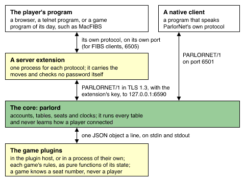
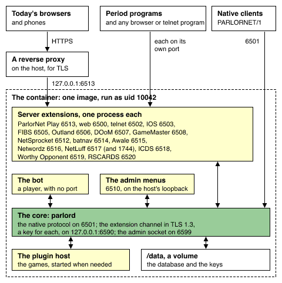

# Architecture and layers (draft 0)

ParlorNet has four layers. Each layer talks only to the one below it, through a narrow interface.

1. **Games** are plugins ([plugins.md](plugins.md)), and they hold rules and state only. They know nothing of sockets, users, servers or federation. They are pure functions that return state and events.
2. **The table host** is the core server, and it owns the tables. Each table is one game instance, and the server that hosts it has the final word on it. That server runs the plugin, orders the moves, keeps the log and ends the game. Each server hosts whichever games it chooses. The core knows seats and players only as opaque ids, and it knows nothing about transport.
3. **The transport layer** carries requests and events between the table host and the players or other servers. Everything that is not a game or a table lives here, as separate pieces that can be swapped:
   - the 8-bit line protocol on a TCP port ([protocol.md](protocol.md))
   - bridges that add TLS, modern identity and rate limits for the open internet
   - federation between servers, described below
   - server extensions ([adapters.md](adapters.md)), such as the web, telnet and game-network extensions. Each one speaks a single protocol to the players' frontends. They run beside the server, but they are not part of it.
4. **The notification layer** sends messages meant for people, such as "it's your turn", by ActivityPub or Mastodon posts, email or anything else. It is optional. It watches table events and never takes part in game or federation traffic. The core gives server extensions a feed of notices for it (`NFY`, under [Notices](protocol.md#notices-nfy) in protocol.md). ParlorNet Play's push notifications are the first to use it ([play-notifications.md](play-notifications.md)).

The picture below shows the path a move takes. An old game program speaks its original protocol to its server extension, which passes the move on to the core. A program that speaks ParlorNet's own protocol talks to the core directly. The core hands the move to the game's plugin and sends the result back the same way.

## Identity and the extension channel

The accounts component (`parlord/accounts.py`) alone decides who a connection is. It runs the sign-in method that the operator chose (`parlord/auth.py`), and it owns the sessions. Neither the table host's game code nor any server extension checks a credential or keeps one. [security-design.md](security-design.md) has the threat model. These are the main points:

- Programs that speak ParlorNet's own protocol, including the 8-bit ones, sign in on the public port, 6501, in plain text. They give the credential that the sign-in method asks for, and the sign-in lasts as long as the connection.
- Every server extension, and the bot, reaches the core on the extension channel. This is the same protocol inside TLS 1.3, with a pre-shared key for each server extension. `python -m parlord.frontends` enrolls, rotates and revokes the keys. A server extension relays the player's answers to the sign-in method's questions and holds the session handle that the accounts component returns. A session can be resumed (`SES`) only on this channel.
- The admin menus reach the core's admin socket over the same kind of channel, with a key for the admin role. The admin socket refuses ordinary extension keys.

## Frontends and server extensions

- A **frontend** is the program a player uses. It can be a web browser, a telnet program, an old game program such as Reversi The Eclipse, MacFIBS, FIBS/W, xfibs or the Outland Gateway, or a program written for ParlorNet's own protocol. It runs on the player's machine, outside the server.
- A **server extension** is a program in the transport layer. It speaks one protocol to frontends and the native protocol to the table host. [protocols.md](protocols.md) describes each protocol and gives its usual port. The table host serves the native protocol itself, on port 6501. In the code, the server extensions are the `adapters/` package. When an extension connects, it declares its protocol's key, port, name and description to the table host, and the table host lists what is connected (`PRL`).

In a running parlor, these are separate processes in one container, as the picture below shows. [Run a server](http://docs.parlornet.org/running.html) and [deploy/README.md](../deploy/README.md) show how to set one up.

## Federation is not notification

- **Federation** is traffic between machines. It covers server identity, players reaching a table on another server, and a federated lobby. A player's identity is `user@domain`, and the player's home server vouches for it with signed requests. Each table has exactly one host, and no game state is replicated.
- **Mastodon and ActivityPub posts** are for people, and they belong to the notification layer. Federation may borrow ActivityPub's mechanics, such as actors, WebFinger and HTTP signatures, but it is a protocol of its own and does not depend on Mastodon.

## Rules of the seams

- A game never learns who a player is, only a seat number.
- The table host never learns how a player connected.
- A transport never interprets game moves. It carries move tokens.
- A transport never checks a credential. It relays the player's answers and holds a session handle.
- Only the table host decides state, legality, randomness, hidden information, results, clocks and identity. Frontends and server extensions are trusted about nothing but the player's own choices. [design/trust.md](design/trust.md) has the rules they follow and checks each service against them.
