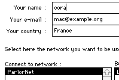
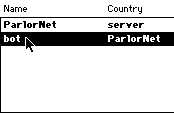
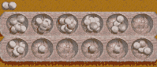
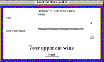

# Awale

## History

Didier and Olivier Guillion of Myriad, in Toulouse, wrote Awale for the Mac and Windows from 1996, with a dozen rules of the Oware family and a computer opponent. Version 2.2.2, dated 1 December 1997, added "live" play over the Internet: the program logs on to an IRC server, joins its own channel there, lists the other Awale players in it and plays them, the moves traveling as messages through the channel. Versions 2.3 and 2.4 (1998 to 2001) kept that way of playing, and version 3.0 (2002) moved Internet play to Myriad's own server. ParlorNet serves the 2.x versions as a small IRC server whose other members are the parlor's players ([protocols guide](../protocols.md#awale)).

## Getting it

Take Awale 2.2.2c for the Mac from Info-Mac. It comes with its own installer, which puts the `Awale 2.2` folder where you choose. It was shareware: unregistered copies play network games, but not the computer's highest levels. Myriad's current Awale is a different program and does not play here. The Windows version is untested.

## Setting it up

Make your account on the web site or by telnet first. The Mac needs MacTCP or Open Transport.

1. Open the `Internet` folder inside the `Awale 2.2` folder. Open `serveurs.cfg` with SimpleText, replace everything in it with the single line `ParlorNet;My parlor;{host};6515`, and save it.
2. Open `internet.cfg` the same way and replace its second line (`giasbm01.vsnl.net.in`) with a single `;`. That turns off the result mail, which would otherwise end every game with an error.
3. Start Awale and choose Internet > Network setup. Fill in your name, pick ParlorNet in the list, and click Connect now.
4. The players' list opens, with ParlorNet and the bot in it. Type `!signin name password` in Write to group and click Send. On a parlor that signs in by name alone, the name you filled in signs you in when you connect.
5. Pick the bot in the list and click Challenge. The bot accepts, and you move first.

Challenging any player in the list invites them; they accept by sitting down, on any frontend. An invitation to you arrives as a challenge, with Accept and Decline. Write to group takes the [shared chat commands](../chat-commands.md), started with `!` because Awale will not send a line that starts with `/`: `!invite NAME`, `!open`, `!join TABLE` or `!join NAME`, `!accept NAME`, `!decline NAME`, `!list`, `!resign`, `!who`, `!motd`, `!help` and `!quit`. During a game, what you type in the box under the board is chat with your opponent.

## Known quirks

- Awale needs a 68020 or later: on an emulated Mac Plus (68000) it stops at launch with an illegal instruction.
- A line typed in Write to group that starts with `/` is refused by Awale itself with "Illegal character."; commands start with `!`.
- ParlorNet's lines show in the message box as `<ParlorNet> : ...`. Parentheses in them become square brackets, because Awale reads its messages by their parentheses.
- Every player shows 100 rating points. ParlorNet keeps no ratings, and the rating Awale shows for you is the program's own count.
- Awale plays only the Oware family. ParlorNet's tables for it play the `oware` rules, the same moves as Awale's own "Awale" rule. An invitation to a Mancala table with store rules is named in the message box and can be played on the web or by telnet.
- The parlor ends a game when a player has more than 24 seeds, and when a position repeats; Awale would play on. Awale then shows "This game was in deadlock. Your opponent canceled it." and counts the seeds captured so far, which at more than 24 are the parlor's final scores. The message box gives the parlor's result.
- When you cannot feed your opponent, the parlor has already ended the game: play any hole and Awale ends it too, with the same count.
- Cancel game resigns the table. A game left when Awale quits or the connection drops stays at the parlor, since Awale cannot come back to a game: finish it on the web or by telnet, or `!resign` it.
- Download update in Network setup fetches the server list from Myriad's old web site, which is gone; it would also replace your `serveurs.cfg`.

## Screenshots

