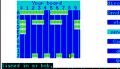
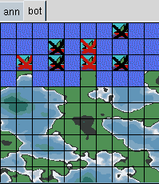
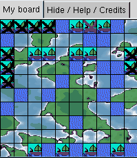
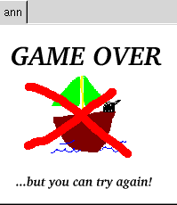

# Batalla Naval (batnav): xbtclient, nbtclient and btwin

## History

Batalla Naval ("naval battle"), or batnav, is Ricardo Quesada's networked Battleship for Linux, from Buenos Aires. One server holds every fleet and judges every shot, for up to five players, and each player runs a client. The X client's first public version, 0.28, came out on 28 December 1995. An ncurses client followed in 1996, and Horacio Pena wrote `btwin` for Windows 3.x, because Windows ran better than X on his slow 386 and 486. Version 0.50 (September 1997) brought the three together, and 0.60 (March 1998) added a GTK client, `gbnclient`. The later gbatnav for GNOME speaks another protocol. Batalla Naval is free software under the GNU GPL.

## Getting it

The 0.50 tarball has the source, i386 Linux binaries of 1997 and `btwin.exe`. The ncurses client builds on Linux today: `gcc -o nbtclient nbtclient.c -lncurses`. The X client needs XView (Debian's `xviewg`, up to Debian 8); 64-bit XView crashed in our tests, so run it as a 32-bit program, such as the 1997 binary on a 32-bit Debian. The [0.60 tarball](https://sourceforge.net/projects/batnav/files/batnav/0.60/) has the GTK client, which builds against GTK 1.2: `gcc -include stdlib.h -include string.h -o gbnclient gbnclient.c $(gtk-config --cflags --libs)`.

## Setting it up

batnav's own server used port 1995; a parlor serves batnav on 6514. Make your account on the web site or by telnet first.

- **X client:** `xbtclient -s {host} -p 6514 -u yourname`, or Config: Host name `{host}`, Server port `6514`, Enter after each, OK, then Disconnect and Connect.
- **ncurses client:** `nbtclient -s {host} -p 6514 -u yourname`, then press a key.
- **Windows client:** with your TCP/IP stack loaded, press Conectar and type `{host}`, `6514` and your name.
- **GTK client:** `gbnclient -s {host} -p 6514 -u yourname`.

1. Sign in with Send Msg (Enviar Mensaje): send `/signin yourname yourpassword`. In the ncurses client type `\signin yourname yourpassword`, since its message field takes the slash key as a backspace. Where the parlor signs in by name alone, the client's name is enough.
2. Place your fleet (one ship of 4 squares, two of 3, three of 2, four of 1, straight and not touching, not even at a corner) and press Send Board.
3. Send `/invite bot`, `/invite NAME` (a player on any frontend) or `/open`. The game starts once every fleet at the table is in.
4. On your turn, click the enemy board (ncurses: Tab to it, arrow keys, space bar).

The message window takes the [shared chat commands](../chat-commands.md): `/invite`, `/open`, `/join`, `/accept`, `/decline`, `/list`, `/close`, `/resign`, `/who`, `/note`, `/motd`, `/help` and `/quit`. Anything else is chat at your table. Invitations arrive as lines there.

## Known quirks

- Each client is player 1 to itself and its opponent player 2.
- Two players only, and only tables with batnav's rules. An invitation to a classic or salvo table says so.
- Start is not needed. Pressing it tells you what the game waits for.
- After a game, send a board again for the next. Disconnect, Quit or a lost connection resigns a game in progress.
- The other fleet is never sent, even to a client started with `-x9`, which saw every fleet on batnav's own server.
- In the X and GTK clients your password stays in the Send Message field: press End, then Ctrl-U to clear it. The X client's message pane wraps at 49 characters.
- The Windows client shows one message at a time in its status line, so the parlor sends it whole sentences. It has connected and signed in under Wine 1.0 on Linux, where its board editor put some squares in the wrong place; no game has been finished with it yet.
- On a password parlor the name typed in the client only labels the connection; you play as the name you sign in with.
- `nbtclient` and `gbnclient` crash at start when the `LOGNAME` environment variable isn't set, because they take the player's name from it. A normal login sets it, so this matters only when a script or a container starts the client.

## Screenshots

