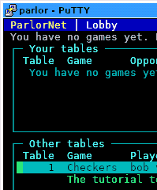
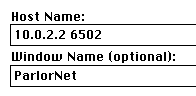

# BetterTelnet

## History

Rolf Braun's BetterTelnet grew out of NCSA Telnet 2.7. Its 1.0 notes are undated, and the 1.2.2 copy on Info-Mac is from November 1997. Its release notes give it ANSI color from 1.0 and bold colors from 1.1. Version 2.0fc1 is the last.

## Getting it

Both copies are fat applications for 68k and PowerPC Macs.

## Setting it up

- BetterTelnet has no port field. In the Open Connection dialog's Host Name field, type the host name, a space and the port, as in `{host} 6502`.

## Known quirks

- It has no IBM PC line characters. It reports itself as a VT220, so the parlor picks the `ansi` display, with ANSI color and plain line characters, without being asked.

## Screenshots

