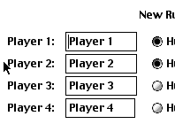
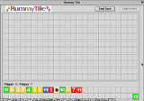
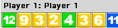

# RummyTile (Black Cat Systems)

## History

RummyTile is a tile rummy game for the Mac by Chris Smolinski of Black Cat Systems, "loosely based on the Turkish game Okey". Version 1.0.1 came out on 24 July 1999 as freeware, for up to four players at one Mac.

It was never networked. Its documentation says "We also hope to add network support for multiplayer games", and Black Cat Systems' page for it still lists "Multi-player / networked play" under Coming Soon. ParlorNet found no other networked tile rummy for the classic Mac. With no network play, there is nothing for a parlor to connect to.

## Getting it

Black Cat Systems' page still offers RummyTile, and Discmaster has its documentation from a 1999 Inside Mac Games CD. ParlorNet links to them and serves nothing of RummyTile.

## Setting it up

RummyTile does not play on a parlor, for the reason under History. Its players can play Rummy Tile on the web, by telnet, in ParlorNet Play or with ParlorNet's Rummy Tile rulebook for GameMaster.

## Known quirks

- Under Mac OS 9.2.2, RummyTile 1.0.1 quit at launch without a word with its own 512K. It started once its preferred memory was raised to 6,000K in the Finder's Get Info window.

## Screenshots

