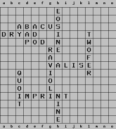
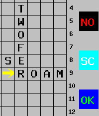
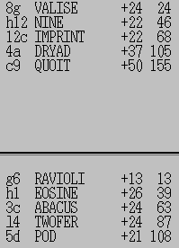

# BobGrid

## History

BobGrid is Mark Watkins' "graphical front-end for the wordgame DOoM of John Chew", written in Java 1.1 in 1999. DOoM was a crossword tile game server that its players otherwise reached with telnet or MUD clients. BobGrid opens a plain connection to a DOoM host, sends DOoM's own commands, and draws the board, the game log and the unseen tiles from what the server prints. Version 2.2 added Pick-and-Click, where you click a square and your rack letters instead of typing a play. Version 2.3, with class files dated October 1999, is the last.

Its author's pages say it should run anywhere Java does. For the Mac they say MRJ needs Mac OS 8.0 or later, and "Don't ask me how to get it to work on a Macintosh". DOoM's last server went quiet around 2005. ParlorNet's DOoM service was built from DOoM's help files and the lines BobGrid reads.

## Getting it

The download is the author's page as the Internet Archive kept it. The author offered the source on request, but no license is stated, so treat the program as all rights reserved.

## Setting it up

- It needs Java 1.1: on Windows Sun's JRE 1.1.8, on Linux the Blackdown JDK 1.1.8 (ParlorNet tested it with that one), on Solaris Sun's JDK 1.1.8. Its author never ran it on a Mac.
- Make your account on the web site or by telnet first.
- In BobGrid's input line, type `/HOST {host} 6507`, then `/GO`. Then `connect name password` signs you in, and `/CONWIZ` saves the host, name and password for next time, after which BobGrid connects and signs in by itself when it starts.
- Type `/1152x864` to make the window large enough to show the scores and the logs.
- `newboard` makes a board of the server's first Grid Words rules, and `newboard 2 NAME` makes one of the rules called NAME, when the server has them. `who` and the board list show each board's rules.
- On ParlorNet you can play Grid Words against anyone on the server, the bot too. Type `invite bot`. Click the square your word starts on (again to go down), then your rack letters; click SC to have the server score the play, then OK to make it. OK without SC makes nothing. BobGrid's board, log windows and tile tracker follow the game.

## Known quirks

- The log windows show dashes for the racks, because the server does not keep them.
- Ratings, time penalties, challenges and the board Workshop are not offered.
- The board is a plain grid: BobGrid draws no premium squares, so you can't see the double and triple letter and word squares. The server still scores them, and SC shows a play's score before you make it.
- `/CONWIZ` keeps your password in plain text, in the file `.bgcfg` in BobGrid's folder.
- Review stops one move short of the latest play; the live board is always up to date.
- The status box at the top right has room for three of its four lines, so the second player's score scrolls out of sight, and the turn bell shows as a small box before "It is ...'s turn."
- Without `/HOST`, BobGrid connects to its built-in default, DOoM's old host at the University of Toronto, so set the host first. When a connection is refused it says "The DOOM may be down."

## Screenshots

