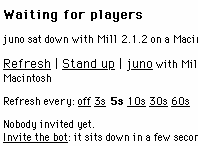

# CAB

## History

CAB is a web browser for the Atari ST, STe, TT and Falcon, by Alexander Clauss, who later wrote iCab for the Mac. Version 0.98 (1995) had no forms. A review of 1.41 in Atari Times issue 6 lists forms, tables and image maps, but the review is undated. The 1.x versions were freeware, and 2.x was sold by Application Systems Heidelberg.

## Getting it

Use version 1.5.

## Setting it up

- Online use needs CAB.OVL with the STiK or STinG TCP/IP stack.
- Open `http://{host}:6500/`.

## Known quirks

- The Atari Times review warns that its forms "are not very reliable", so signing in may take a second try.

## Screenshots

