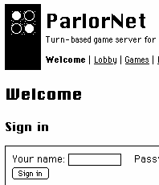
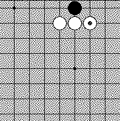
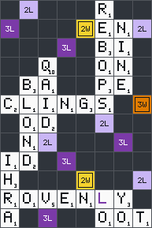

# Cyberdog

## History

Cyberdog is Apple's Internet suite for the Mac, built on OpenDoc. Version 1.0 came out in May 1996, and Apple's Cyberdog Technical FAQ of that month lists "HTML 2.0 plus ... Tables". HTML 2.0 brings forms and server-side image maps. Version 2.0 is the one linked here.

## Getting it

There are separate installers for 68k and PowerPC Macs.

## Setting it up

- It needs a 68030 or better or a PowerPC Mac, 16 MB of memory, System 7.5.3, OpenDoc 1.2, and MacTCP 2.0.4 or Open Transport 1.1.
- Open `http://{host}:6500/`.

## Known quirks

Nothing known yet.

## Screenshots

