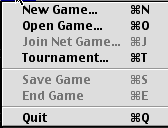
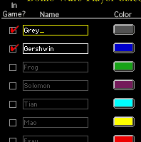
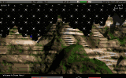
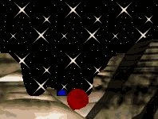

# Dome Wars

## History

Dome Wars is an artillery game for the Mac by Nathan Sturtevant, in which domes on a landscape take turns firing shells and weapons at each other. Version 1.0 was on a MacFormat CD in January 1996. Version 1.2b1, copyright 1995 to 1997, is the only version known to play over a network: through Apple's NetSprocket, on PowerPC Macs only, with one Mac hosting and the others joining. Later versions up to 1.5.1 tell players to use 1.2b1 for network games.

ParlorNet read the 1.2b1 program's PowerPC code to see whether a parlor, acting as the NetSprocket host, could drive it with Cannon Fire's physics. Every Mac in a game works out each shot itself, flying the shell, digging the craters and dealing the damage, and no message can say where a shell went. A host can resend the landscape and every dome after a shot, so a player would see the shell land where Dome Wars puts it and then the world jump to the parlor's result. A fair game would need Dome Wars' own physics on the server, which ParlorNet does not plan.

## Getting it

The Dome Wars 1.2 folder from an Inside Mac Games CD is on Discmaster, and Macintosh Garden has other versions. ParlorNet links to them and serves nothing of Dome Wars.

## Setting it up

Dome Wars does not play on a parlor, for the reason under History. Its players can play Cannon Fire on the web, by telnet, in ParlorNet Play or with ParlorNet's Cannon Fire rulebook for GameMaster.

## Known quirks

- Network play needs a PowerPC Mac, as its Read Me says; the 68k code has no network play.
- In an emulator, a copy of 1.2b1 could not host a game, so two copies were never seen playing each other there.

## Screenshots

