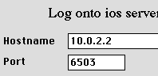
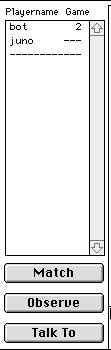
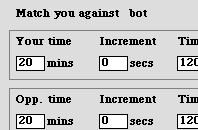
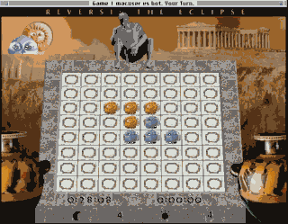

# Reversi The Eclipse

## History

Reversi The Eclipse is a Reversi game for the Mac by Lars Graulund, published as shareware (US$19.95) by Freeverse Software. Version 1.2, uploaded to Info-Mac by Freeverse in November 1997, was the last. The dates of earlier versions were not found. It is a fat application, with 68k and PowerPC code built from the same source.

Besides playing on one Mac, it could play over the Internet on the Internet Othello Server (IOS), which Igor Durdanovic started in 1993. Its log-on dialog still names that server's last home, `external.nj.nec.com` port 5000. IOS was replaced by its successor, GGS, around 1999 to 2000, and from then on the game had no server to connect to. ParlorNet's IOS service follows what Eclipse 1.2's code reads.

Freeverse's FAQ said "There are no known bugs in Eclipse", but the 68k code has one that stops it connecting at all. It was found in 2026, and the [Eclipse 68k Fix](http://docs.parlornet.org/eclipse-68k-fix.html) mends it.

## Getting it

Use version 1.2, the only version the 68k fix accepts. Freeverse no longer sells the game and its site is gone.

## Setting it up

- It runs on Macs with a 68020 or later, and on PowerPC Macs. It does not run on a 68000 Mac (Plus, SE, Classic): on an emulated Mac Plus it stops at launch with a system error.
- On a 68k Mac, fix your copy with the [Eclipse 68k Fix](http://docs.parlornet.org/eclipse-68k-fix.html) first. PowerPC Macs do not need it.
- Choose Internet > Log on IOS. Type `{host}` as the Hostname and `6503` as the Port, then your login name and password.
- On ParlorNet you can play Reversi against anyone on the server, web and telnet players included. The Players & Command Window lists who is online, and Match, Observe and Talk To work, as do accepting and declining challenges. To play the bot, pick `bot` in the list and click Match.

## Known quirks

- On 68k Macs, version 1.2 turns every host name shorter than 32 characters into repeats of its first letter, so it cannot connect. The [Eclipse 68k Fix](http://docs.parlornet.org/eclipse-68k-fix.html) changes two bytes in your copy to fix it.
- IOS login names are at most 8 letters and digits, so an account with a longer name cannot sign in from Eclipse.
- With the suggested 7,000K, the game said there was not enough memory to create a new game window, in 256 colors as well as in millions. Giving it 12,000K in the Finder's Get Info window fixed it.
- Games here are unrated, so there are no ratings to see.

## Screenshots

