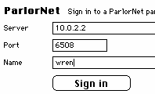
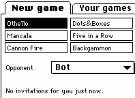
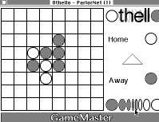
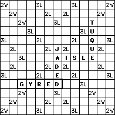

# GameMaster

## History

GameMaster was written by Rhys Hollow at the University of Western Australia in 1991, with Peter N. Lewis, who wrote its MacTCP code and five of its games, and Quinn, who wrote the programmer's manual. It is a game server for two players. Each game is a "rulebook", a small file of code, and two Macs play it over MacTCP or AppleTalk. When the other Mac lacks a rulebook, GameMaster offers to teach it. Version 1.0.0 came out as Povertyware in December 1991 with ten rulebooks, among them Dots&Boxes, Othello, BattleShips and Simple Talk, and a developer's kit with the Pascal source of every rulebook. Isolation, Gravity Wars and Crystal Ball, a rulebook for finding opponents, followed in 1992 and 1993.

In 2026 ParlorNet wrote rulebooks of its own for GameMaster 1.0.0. [ParlorNet's own rulebook](http://docs.parlornet.org/parlornet-rulebook.html) signs you in to a parlor and starts every game, GameMaster's own Othello, Dots&Boxes and BattleShips among them. Seven [game rulebooks](/gamemaster-rulebooks.html) add Checkers, Mancala, Five in a Row, Grid Words, Rummy Tile, Cannon Fire and Backgammon. They are plain 68000 code, written in C and built with the Retro68 toolchain, and they draw in black and white for a Mac Plus screen. Their source and releases are in their own repository, [eric-cgn/parlornet-gamemaster](https://github.com/eric-cgn/parlornet-gamemaster), and they are free software under the MIT license.

## Getting it

Getting GameMaster ready for a parlor takes two downloads, in this order.

1. **Get GameMaster 1.0.0.** Download `gamemaster1.0.cpt.hqx` from [ParlorNet's FTP site](ftp://ftp.parlornet.org/clients/apple/macintosh_68k/gamemaster/), or take the GameMaster folder from one of the archives above. Unpack it with StuffIt Expander or Compact Pro, and keep `GameMaster`, `Dots&Boxes`, `Othello` and `BattleShips` together in one folder.
2. **Get Install ParlorNet Rulebooks.** Download it as `.bin`, `.hqx` or `.dsk` from [the game rulebooks page](/gamemaster-rulebooks.html#download), from [ParlorNet's FTP site](ftp://ftp.parlornet.org/clients/apple/macintosh_68k/) or from [its release on GitHub](https://github.com/eric-cgn/parlornet-gamemaster/releases). Open it and follow its steps. If Install Location isn't the folder that holds GameMaster, click Choose... and pick that folder. It installs the ParlorNet rulebook and all seven game rulebooks there.

The parlor plays three of GameMaster's own rulebooks, Othello, Dots&Boxes and BattleShips, and turns the others down.

## Setting it up

You need ParlorNet's own rulebook to play on a parlor. It carries every game, GameMaster's own Othello, Dots&Boxes and BattleShips as well as ParlorNet's seven. The parlor turns down a game connected with GameMaster's Game > Connect, and GameMaster can't learn the rulebook from the parlor, because it only learns a rulebook from the Mac that calls it.

It needs MacTCP or Open Transport's TCP/IP. ParlorNet's rulebooks run on a Mac Plus or later with System 6.0 or later.

1. Open GameMaster and choose File > New Game > ParlorNet. Type `{host}` in the Server field and `6508` in the Port field. A new copy already has a server named there, so type over it. Type your name and click Sign in, then answer what the server asks, such as your password. Make your account on the web site or by telnet first.
2. On the New game tab, choose a game and an opponent (Bot, Wait for opponent, a player online, Other...). Click "Othello vs the bot", say. Invitations show there with Accept and Decline.
3. Your games lists your games, with Resume for ParlorNet's own games. All games has Join where someone waits. Closing the window ends the games started from it. Resumed games stay.

To play the bot, choose Bot in the Opponent menu. With Wait for opponent, you play whoever joins your table, or the bot if nobody joins within a minute.

On ParlorNet, Dots&Boxes is won by the first to hold more than half its 13 by 11 boxes. BattleShips fires six shots a turn. Your new game moves first. In Othello and ParlorNet's games, if the other player already sits first, the parlor asks to swap players.

## Known quirks

- At a BattleShips table, each player's own program receives the other player's fleet when shooting starts, because GameMaster works out the hits on the Mac. Players on the web and by telnet see each of their shots land at once, while you see your six together after Fire.
- In BattleShips, the other player's salvo shows only after you press OK on your own.
- "isn't interested" means the parlor turned the game down. That happens with a game connected with Game > Connect rather than from the ParlorNet window, a rulebook it doesn't play, or a saved game. Start a new game from the ParlorNet window.
- GameMaster's saved games can't go to the parlor, so choose Discard when asked to save. Your games takes unfinished games up.
- Dots&Boxes draws its 13 by 11 boxes small, so click right on a line.
- While the parlor looks for your opponent, the window shows nothing new. With a named player it can wait up to three minutes.
- Swap and Restart from your Mac are declined.
- GameMaster plays two. Tables for three or more players are left out of the ParlorNet window, and an invitation to one is turned down with the reason. Grid Words, Rummy Tile and Cannon Fire can have more, so play those tables on the web, by telnet or in ParlorNet Play.
- Grid Words, Rummy Tile, Cannon Fire and Backgammon play only on a parlor, which deals the tiles, checks the words and turns, flies the shells and rolls the dice. Checkers, Mancala and Five in a Row also play between two Macs that both have the rulebook.
- The Grid Words rulebook draws the bonus squares and the letter values that the parlor sends for the table, so it plays every Grid Words ruleset the server has. Grid Words 1.1.1 and older draw a board of their own, which doesn't match the standard rules, so use 1.2.0 or later.
- Backgammon draws your home board on the right. Home left (or H) draws the mirror image, and the parlor keeps that choice for your next game in GameMaster. It is kept apart from the same choice on the web and by telnet.
- ParlorNet's own games take up where they were left. Resume on Your games picks one up, even a game started on the web, by telnet or in another program such as Outland.

## Screenshots

