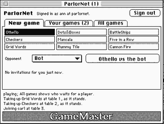
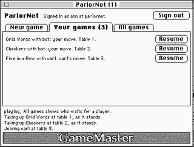
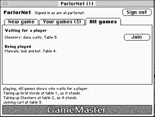

# GameMaster

## History

GameMaster was written by Rhys Hollow at the University of Western Australia in 1991, with Peter N. Lewis, who wrote its MacTCP code and five of its games, and Quinn, who wrote the programmer's manual. It is a game server for two players. Each game is a "rulebook", a small file of code, and two Macs play it over MacTCP or AppleTalk. When the other Mac lacks a rulebook, GameMaster offers to teach it. Version 1.0.0 came out as Povertyware in December 1991 with ten rulebooks, among them Dots&Boxes, Othello, BattleShips and Simple Talk, and a developer's kit with the Pascal source of every rulebook. Isolation, Gravity Wars and Crystal Ball, a rulebook for finding opponents, followed in 1992 and 1993.

## Getting it

**GameMaster 1.0.0 and its rulebooks** are not ParlorNet's to hand out; the archives above have them. The parlor plays three of the set's rulebooks, Othello, Dots&Boxes and BattleShips, and turns the others down.

**ParlorNet's rulebooks**, built and released in their own repository, [eric-cgn/parlornet-gamemaster](https://github.com/eric-cgn/parlornet-gamemaster): [ParlorNet's own rulebook](http://docs.parlornet.org/parlornet-rulebook.html), which signs you in and starts games, and the [game rulebooks](http://docs.parlornet.org/gamemaster-rulebooks.html): Checkers, Mancala, Five in a Row, Grid Words, Rummy Tile, Cannon Fire and, from Install ParlorNet Rulebooks 1.4, Backgammon, from 2026 (their own page: [ParlorNet rulebooks for GameMaster](/clients/parlornet-rulebooks.html)). Install ParlorNet Rulebooks, there, puts them all in the folder that holds GameMaster: open it and follow its steps (Choose... picks the folder).

## Setting it up

You need ParlorNet's own rulebook to play on a parlor. It carries every game, GameMaster's own Othello, Dots&Boxes and BattleShips as well as ParlorNet's seven. The parlor turns down a game connected with GameMaster's Game > Connect, and GameMaster cannot learn the rulebook from the parlor, because it only learns a rulebook from the Mac that calls it.

It needs MacTCP or Open Transport's TCP/IP. ParlorNet's rulebooks run on a Mac Plus or later with System 6.0 or later.

1. Open GameMaster and choose File > New Game > ParlorNet. The Server field holds `{host}` and the Port field `6508`. Type your name and click Sign in, then answer what the server asks, such as your password. Make your account on the web site or by telnet first.
2. On the New game tab, choose a game and an opponent (Bot, Wait for opponent, a player online, Other...). Click "Othello vs the bot", say. Invitations show there with Accept and Decline.
3. Your games lists your games, with Resume for ParlorNet's own games. All games has Join where someone waits. Closing the window ends the games started from it; resumed games stay.

To play the bot, choose Bot in the Opponent menu. With Wait for opponent, you play whoever joins your table, or the bot if nobody joins within a minute.

On ParlorNet, Dots&Boxes is won by the first to hold more than half its 13 by 11 boxes. BattleShips fires six shots a turn. Your new game moves first; in Othello and ParlorNet's games, if the other player already sits first, the parlor asks to swap players.

## Known quirks

- At a BattleShips table, each player's own program receives the other player's fleet when shooting starts, because GameMaster works out the hits on the Mac. Players on the web and by telnet see each of their shots land at once, while you see your six together after Fire.
- In BattleShips, the other player's salvo shows only after you press OK on your own.
- "isn't interested" means the parlor turned the game down: a game connected with Game > Connect rather than from the ParlorNet window, a rulebook it does not play, or a saved game. Start a new game from the ParlorNet window.
- GameMaster's saved games cannot go to the parlor: choose Discard when asked to save. Your games takes unfinished games up.
- Dots&Boxes draws its 13 by 11 boxes small, so click right on a line.
- While the parlor looks for your opponent, the window shows nothing new. With a named player it can wait up to three minutes.
- Swap and Restart from your Mac are declined.
- GameMaster plays two. Tables for three or more players (Grid Words, Rummy Tile and Cannon Fire can have more) are left out of the ParlorNet window, and an invitation to one is turned down with the reason; play those on the web, by telnet or in ParlorNet Play.

## Screenshots

