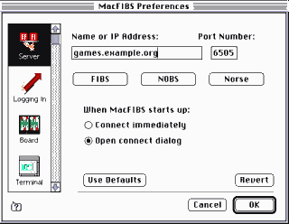
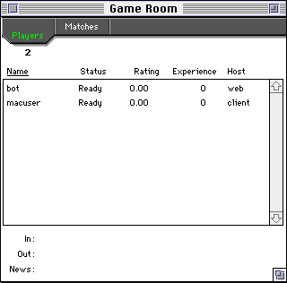
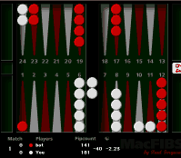

# MacFIBS 3

## History

MacFIBS is Paul D. Ferguson's Mac client for FIBS, the First Internet Backgammon Server. Version 1.0 was posted to Info-Mac in September 1994, and with FIBS/W for Windows it was one of the first graphical FIBS clients. Version 2.0.3 followed in April 1995 as freeware. MacFIBS 3 came out in January 1998 as shareware, with separate builds for 68K and PowerPC Macs. Its author's page also offers MacFIBS 4.5.3 for PowerPC Macs with Mac OS 8.6 or later.

MacFIBS draws the board in its own window, keeps a Game Room with the player list, and opens dialogs for invitations, doubles and resignations. MacFIBS 3 r6 (3.0.6) was tested against ParlorNet in an emulator and on a PowerBook 165.

## Getting it

MacFIBS 3 is shareware, and its ReadMe asks you to register once you have played more than ten games. Take the 68K or the PowerPC build to suit your Mac. MacFIBS 4.5.3 has not been tried with ParlorNet.

## Setting it up

- MacFIBS 3 needs a Mac with a 68020 or later, or a PowerPC Mac, and MacTCP or Open Transport.
- It opens its Preferences the first time it starts. In the Server pane, type `{host}` under Name or IP Address and `6505` under Port Number.
- Put your name and password in the Logging In pane, or type them in the dialog that File > Connect opens.
- On ParlorNet you can play Backgammon matches against anyone on the server. Invite from the Player menu or accept an invitation in its dialog, then play on the board, double, resign and chat. To play the bot, type `invite bot 1` in the Terminal window.

## Known quirks

- The 68K build needs a 68020 or later: on an emulated Mac Plus (68000) it stops at launch with a system error.
- If you click the dice before finishing your move, MacFIBS sends the part you have made. The server refuses it, and the board keeps showing the partial move until you choose Game > Refresh Board.
- MacFIBS does not notice when the server drops the connection. Use File > Disconnect, then File > Connect.
- In about 3 sessions out of 10 the player list stays empty for the whole connection. Quit MacFIBS and open it again.
- While the player list is empty, an invitation's dialog can be empty too, and accepting it fails. Quit and reopen MacFIBS, and ask the other player to invite you again.
- The Preferences have a hidden, unfinished "Use CLIP" setting. Leave it off.
- Games here are unrated, so the rating column shows 0.00. Redoubles, beavers and stored messages are not offered.

## Screenshots

