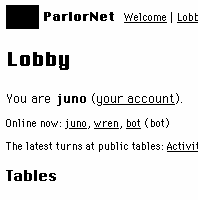

# NCSA Mosaic (Mac)

## History

NCSA Mosaic came from the National Center for Supercomputing Applications. Mac Mosaic 2.0 (1995) has tables, forms and server-side image maps (ISMAP), but no client-side ones; TidBITS wrote about its table support in March 1995. The README of 2.0.1 (2 October 1995) mentions that "Large tables are now handled more efficiently", along with fixes to forms and IsMap. Mosaic for Windows had all three from 2.0 (October 1995), but no copy is linked here. Mosaic for X is left out, because its tables could not hold other markup.

## Getting it

Use 2.0.1, in the 68K or the PowerPC build.

## Setting it up

- Open `http://{host}:6500/`. Boards are clicked through the server-side image map.

## Known quirks

- Mosaic has no cookies, so your session goes in each link (`s=`). Do not pass those links on to anyone.

## Screenshots

