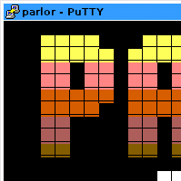

# NCSA Telnet

## History

NCSA Telnet came out for the Mac and MS-DOS in 1986, from the National Center for Supercomputing Applications at the University of Illinois. Version 2.7b4 is the last Mac version, with files dated June 1995 in Info-Mac's copy, and it is a fat application for 68k and PowerPC Macs. BetterTelnet grew out of it.

## Getting it

It runs on any Mac from System 6.

## Setting it up

- It needs MacTCP or Open Transport.
- Choose Open Connection, with host `{host}` and port `6502`, or type `{host} 6502`.
- It emulates a VT102 or VT220.

## Known quirks

- The name you type at `Login` and at `Name you want` shows twice, once as you type it and again on the next line. Signing in still works.
- It has no IBM PC line characters, so pick the `ansi` display. Info-Mac's `comm/inet/ansi-bbs-telnet-patch.hqx` adds an IBM-style font, after which the `pc` display works too.

## Screenshots

