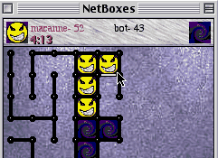

# NetBoxes 1.1

## History

Will Helling wrote NetBoxes as Brainfreeze Entertainment, and version 1.1 is dated 22 March 2000. It is Dots and Boxes for two to four players on PowerPC Macs, over a local network or the Internet through Apple's NetSprocket: one copy hosts, and the others join by address and port. To the classroom game it added a turn clock that docks a point for every second over, a score in points rather than boxes, and mines. Version 1.1 added a version check and the host's choice to keep joiners from starting or stopping games. It was US$10 shareware, one of the ten shareware games on Macworld's CD of June 2000, and GameRanger could find opponents for it. Every copy keeps the whole game itself, and ParlorNet acts as the host, so a Mac joins the parlor as it would join another Mac ([protocols guide](../protocols.md#netsprocket)).

## Getting it

The ReadMe asks US$10 of players who keep it. NetBoxes needs Apple's NetSprocket, which Mac OS 9 does not include. Some games that use it install `NetSprocketLib` in the Extensions folder; otherwise take it from Apple's NetSprocket SDK linked above, put it there and restart.

## Setting it up

It needs a PowerPC Mac with Mac OS 8 or 9, Open Transport's TCP/IP and a working network. Make your account on the web site or by telnet first.

1. Start NetBoxes and choose Join Net Game from the File menu.
2. Choose TCP/IP from the Network menu. Type `{host}` as the host name and `6512` as the port, your ParlorNet name as the player name and your ParlorNet password as the password. If the server emailed you your password, sign in once on the web or by telnet first, where you choose a password of your own.
3. The chat window opens, with ParlorNet as the other player. Type `/invite bot` to play the bot. The game starts by itself when the bot sits down.

The chat box takes the [shared chat commands](../chat-commands.md):

- `/invite bot` plays the bot, and `/invite NAME` invites a player on the web, by telnet or on another Mac. Add a size for another board than 5 by 5 boxes: `/invite bot 7x4`.
- `/open` opens a table anyone can join, with a size if you like and `3` or `4` for more players: `/open 6x6 3`. `/join TABLE` or `/join NAME` sits you down at an open table.
- `/accept NAME` and `/decline NAME` answer an invitation.
- `/resign` resigns the game you are playing, after a second `/resign` to confirm.
- `/list` lists your games and the open tables, and `/close` closes your open table.
- `/who`, `/motd`, `/help` and `/quit` show the players online, the message of the day and the commands, and sign out.

Anything else you type is chat with the other players once you have a table.

## Known quirks

- The first Join after starting NetBoxes often fails at once, with nothing on screen. Choose Join Net Game again.
- NetBoxes opens its chat window before the parlor answers. A wrong name or password is said there, and then the program shows "The game host has left!".
- Games start from the parlor when every seat is taken, so Start Game and Abort Game stay gray. To leave a game, type `/resign`, or close the game window, which resigns it.
- When you have the first turn, the game starts with your opponent's name lit, and the turn comes to you a moment later. NetBoxes lets only the player who started a game move first, so the parlor's player passes once on your screen only.
- NetBoxes counts its own points: one a line, eight a box, and one off for each second over the turn clock. The parlor counts boxes, and its result stands; the chat box gives it at the end. The end screen shows each player's boxes twice over, and on a tie it calls you the winner.
- The turn clock on your screen is the table's time per turn, up to 4 minutes 15 seconds, the most NetBoxes can show. Running over costs points on your screen only.
- Tables with the majority rules (13 by 11 boxes, over at more than half) cannot be played, because NetBoxes plays until the board is full. `/accept` and `/join` say so.
- The game window shows ten characters of a name. Your own may show a letter or two of a longer name used before it; quit NetBoxes and start it again to clear them.
- When nothing has happened for a while, the chat box shows the time left for the turn, such as "ParlorNet: Your move: 28m left.", which also keeps the connection open.
- Mines and random lines are not used.

## Screenshots

