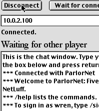
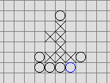
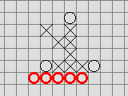
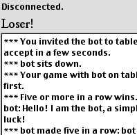

# NetLuff

## History

Henrik Linder of Lindesberg, Sweden, wrote NetLuff, a five-in-a-row game for two Macs over the Internet. Version 1.4 is dated 10 October 1998; it was US$10 shareware, and its Read Me lists what was new in 1.4 and the author's plans. Luffarschack is the Swedish name of the game. One player waits for a connection and the other types that Mac's address. The board is 20 by 20, five or more in a row wins, and the window has a chat box with `/me`, a ping button and a "Page!" button that plays a sound on the other Mac. It is written in REALbasic and runs on 68030 and PowerPC Macs with Open Transport. ParlorNet acts as the waiting Mac, so NetLuff connects to the parlor as it would to another copy ([protocols guide](../protocols.md#netluff)). No other version was found in the archives.

## Getting it

Info-Mac has version 1.4 as a BinHexed StuffIt archive with the program and its Read Me. One program runs on both 68k and PowerPC Macs.

## Setting it up

It needs System 7.5.1 or later (7.1 with the Thread Manager), a 68030 or better, Open Transport's TCP/IP and a working network. Make your account on the web site or by telnet first.

1. Start NetLuff. Type your ParlorNet name in the "Your name" box.
2. Type `{host}` (the parlor's name or address) in the "Remote IP here" box and click Connect. NetLuff always connects to port `1744`; you cannot change it, so the parlor must publish 1744.
3. The chat box greets you. Type `/signin` and your password, or `/signin NAME PASSWORD` for another name. If the server emailed you your password, sign in once on the web or by telnet first, where you choose a password of your own.
4. Type `/invite bot` to play the bot. When the game starts, the window's title names your opponent, and the chat box says who moves first.

The chat box takes the [shared chat commands](../chat-commands.md):

- `/invite bot` plays the bot, and `/invite NAME` invites a player, who may be on the web, by telnet or on another Mac.
- `/open` opens a table anyone can join, and `/join TABLE` or `/join NAME` sits you down at an open table made from NetLuff.
- `/accept NAME` and `/decline NAME` answer an invitation.
- `/resign` resigns the game you are playing, after a second `/resign` to confirm.
- `/list` lists your games and the open tables, and `/close` closes your open table.
- `/who` lists the players online, `/note` reads or adds a note to the game, `/motd` shows the message of the day, `/help` lists the commands and `/quit` signs out.

Anything else you type is chat with your opponent once you have a table.

## Known quirks

- NetLuff needs a 68030 or later and Open Transport: on an emulated Mac Plus (68000) it stops at launch with a system error.
- NetLuff has no port setting and always connects to port 1744. A parlor that publishes only 6517 cannot be reached from it.
- NetLuff sends your name but no password, so you sign in in the chat box. Your password shows in your own chat box as you typed it; only the parlor receives it.
- The parlor's own lines in the chat box start with "*** ", as NetLuff's own notes do.
- Only the 20 by 20 freestyle tables made from NetLuff can be played on it. When a player on the web or by telnet invites you, `/accept` says so; `/invite` them to a table of yours instead. They see a 20 by 20 board.
- A line of six or more wins, as it does in NetLuff itself.
- The parlor decides who moves first; NetLuff's own random pick is not used.
- When your opponent makes five, NetLuff draws the line in red, shows "Loser!" and disconnects. When you make five, it shows "Victory!" and disconnects. That is how two copies of NetLuff end a game.
- A resignation, running out of time or a full board ends the game in the chat box instead, and NetLuff stays connected for a while.
- NetLuff clears its board only when it connects, so each connection plays one game. Click Disconnect, then Connect, to play again.
- Disconnecting during a game resigns it, since NetLuff cannot show a game in progress again.
- The Page! button is not passed on to your opponent. Invitations and the start of a game play NetLuff's page sound, if "Enable pager" is checked in its preferences.
- When nothing happens for a while, the parlor pings NetLuff, which answers by itself and shows nothing, unless "Display ping requests" is checked.

## Screenshots

