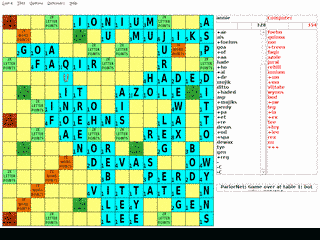
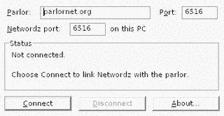

# Networdz 2.0

## History

Networdz is a crossword tile game for Windows 3.1 and later by Lance Frohman of San Francisco. Version 2.0 has files dated October 1996 and was US$12 shareware, sold on CD collections from 1996 to 1998. One to four people play, on one PC or over a network or the Internet, in 16 languages. Version 2.0 was the first to play over a network: two to four PCs over a LAN or the Internet, through Winsock. It also plays against the computer and has a chat window, a timed option and tournament rules, and its configuration files change the board, the tiles and the language.

There is no server: one player's copy is the host. It deals, checks every word against its dictionary and connects out to each remote player's copy, which waits in Answer mode. On a parlor the parlor is always that host. A Networdz player is a guest at an ordinary Grid Words table, beside players on the web, by telnet, in ParlorNet Play, on the 8-bit clients, in GameMaster, the bot and other Networdz players. The parlor deals, judges every word with its own word list and ends the game ([protocols guide](../protocols.md#networdz)).

## Getting it

The archive below is from Walnut Creek's Giga Games 5 CD of June 1997. It holds the program, its help file, the English and Spanish dictionaries and the configuration files. You don't need its installer: copy the files into a folder such as `C:\NETWORDZ`.

## Setting it up

In Answer mode Networdz waits for its host to connect, and a parlor never connects to players' machines. ParlorNet Link, a small program of ParlorNet's own (above), connects to both and passes everything between them.

You will need Windows 3.1 or later with Winsock, ParlorNet Link, and an account, which you make on the web site or by telnet. Then:

1. Save the text under `PARLOR.CFG` below in the Networdz folder: the standard board, the 100 standard tiles and their points, and racks of 7.
2. Start Networdz, choose Options, Configuration and open `PARLOR.CFG`.
3. Choose Options, Communicate, Answer Mode, type your name, choose Connect, then OK.
4. Start ParlorNet Link, type `{host}` and port `6516`, and choose Connect (it reads Networdz's port from `NETWORDZ.INI`). The parlor's welcome shows in Networdz.
5. Choose Options, Chat, where the parlor's lines come. Type `/signin NAME PASSWORD`, or `/signin PASSWORD` for the name you gave Networdz. If the server emailed you your password, sign in once on the web or by telnet first, where you choose a password of your own.
6. Type `/invite NAME` to play someone, `/invite bot` to play the bot, `/open` to let anyone sit down, or `/join` a table from `/list`. The game starts in Networdz once everyone is seated.

`PARLOR.CFG`:

```
[Board]
Squares per side=15
row 1=T..d...T...d..T
row 2=.D...t...t...D.
row 3=..D...d.d...D..
row 4=d..D...d...D..d
row 5=....D.....D....
row 6=.t...t...t...t.
row 7=..d...d.d...d..
row 8=T..d...C...d..T
row 9=..d...d.d...d..
row 10=.t...t...t...t.
row 11=....D.....D....
row 12=d..D...d...D..d
row 13=..D...d.d...D..
row 14=.D...t...t...D.
row 15=T..d...T...d..T

[Tiles]
Blank Count=2
Letters=ABCDEFGHIJKLMNOPQRSTUVWXYZ
Tiles per rack=7
A Tiles=9
A Points=1
B Tiles=2
B Points=3
C Tiles=2
C Points=3
D Tiles=4
D Points=2
E Tiles=12
E Points=1
F Tiles=2
F Points=4
G Tiles=3
G Points=2
H Tiles=2
H Points=4
I Tiles=9
I Points=1
J Tiles=1
J Points=8
K Tiles=1
K Points=5
L Tiles=4
L Points=1
M Tiles=2
M Points=3
N Tiles=6
N Points=1
O Tiles=8
O Points=1
P Tiles=2
P Points=3
Q Tiles=1
Q Points=10
R Tiles=6
R Points=1
S Tiles=4
S Points=1
T Tiles=6
T Points=1
U Tiles=4
U Points=1
V Tiles=2
V Points=4
W Tiles=2
W Points=4
X Tiles=1
X Points=8
Y Tiles=2
Y Points=4
Z Tiles=1
Z Points=10
```

The Chat window takes the [shared chat commands](../chat-commands.md):

- `/invite NAME` invites a player, who may be on the web, by telnet or anywhere else, and `/invite bot` invites the bot.
- `/open` opens a table for two that anyone can join, `/open 3` or `/open 4` one for more players, and `/close` closes it before the game starts. `/join TABLE` or `/join NAME` sits down at an open table, and `/accept NAME` or `/decline NAME` answers an invitation.
- `/resign` resigns the game, after a second `/resign` to confirm.
- `/list` lists your games and the open tables, `/who` the players online, `/tables NAME` a player's tables, `/top` the leaderboard and `/score` a score. `/note` reads or adds a note to the game, `/time` shows the time, `/motd` the message of the day, `/help` the commands, and `/quit` signs out.

Anything else you type is chat with the other players.

## Known quirks

- Networdz's protocol sends the bag and every rack to each player's program, so a table where a Networdz player sits is marked `integrity=false`, with the line "Integrity: a Networdz program receives the bag and all racks." in the chat and in the table's log. Networdz shows you only your own rack, and the game goes on as at any other table.
- A word the parlor's list lacks shows in Networdz as not in the dictionary, with at most five letters of it. A play whose tiles are not in a line, do not touch the board or miss the center square shows Networdz's own message for it. Either way the chat gives the table's reason; take your tiles back and play again.
- The bot shows in Networdz as Computer, and the parlor's own lines come under the name ParlorNet, or with no name when all four seats play.
- The parlor plays the standard board and tiles only: load `PARLOR.CFG` before you connect.
- Trade Blanks, Exchange 4 of a kind, Timed and Tournament Rules are not played here; the parlor sends them off.
- A game you leave goes on at the parlor: finish it on the web or by telnet, or `/resign` it. Networdz cannot load a game back.
- Networdz answers once each time you choose Connect in its Communicate box. To play again after a connection ends, choose Disconnect and then Connect there, and ParlorNet Link connects again by itself.
- On a Winsock without `127.0.0.1` (Trumpet, reportedly), ParlorNet Link tries your PC's own address; its README says what else to try.

## Screenshots



