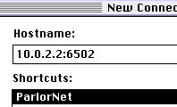

# NiftyTelnet

## History

Chris Newman's NiftyTelnet 1.1 is from 1996. It is freeware for System 7 Macs and offers "complete VT102 emulation".

## Getting it

The Info-Mac copy is version 1.1.

## Setting it up

- It needs MacTCP or Open Transport.
- NiftyTelnet has no port field. Choose New Connection and type the host name, a colon and the port in the Hostname field, as in `{host}:6502`. With a space instead, it says it can't find a host by that name.

## Known quirks

- It reports itself as a VT102, so the parlor sends plain ASCII boards in black and white.

## Screenshots

