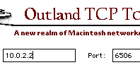
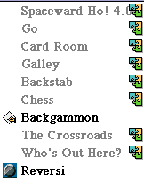
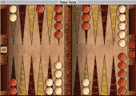
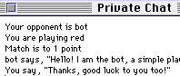

# Outland Gateway, Backgammon and Reversi

## History

Outland was an online games service for the Mac, run by Outland, Inc. from Palo Alto from 1994. Players used the free Outland Gateway to reach it by modem or over the Internet, and paid US$9.95 a month. Each game was its own application that talked to the Gateway: Spaceward Ho!, Chess, Reversi, Hearts, Backstab and others. Reversi was among its first games, and Backgammon, by Aaron Barnett, was part of it by early 1995. Gateway 1.3.2 is dated 1994 to 1995.

Outland's own memorial page says the service ran from roughly 1993 to 1998, until its database server failed, and that the founders did not revive it. Its protocol was never published. ParlorNet's Outland service was recovered from the 1994 to 1995 client software.

## Getting it

Take the Macworld CD's installer, which has both games. Use Gateway 1.3.2 with the August 1995 game set.

## Setting it up

It needs a Mac with a 68020 or later, or a PowerPC Mac, and a working TCP/IP setup with MacTCP or Open Transport. Both games are 68k code. These steps were confirmed with Gateway 1.3.2 on System 7.6.1.

1. Quit the Gateway. Drop "Outland TCP Tool" on the closed System Folder, and the Finder puts it in the Extensions folder. Restart to be safe. The Gateway only offers the connection tools that are in Extensions, which is why only the modem and serial tools show up without it.
2. In the Gateway's start window, the one with the Connect button, choose Settings > Connection... to open Connection Settings. Set the Method pop-up to "Outland TCP Tool". Two fields appear, Address (it says `dover.outland.com`) and Port (it says `4000`). Type `{host}` as the address and `6506` as the port, then click OK. If clicking and deleting does not change a field, press Tab until the field's text is selected, then type over it.
3. Leave Settings > Direct checked and Telnet unchecked. Telnet is the old dial-up route through a shell account.
4. Click Connect, choose "Registered user" (the default is New user), and type your ParlorNet name and your password. If the server emailed you your password, sign in once on the web or by telnet first, where you choose a password of your own.
5. Once the settings are made, quit with File > Quit. The Gateway seems to save the host only when it quits normally.

When you are connected, the Outland Services window lists Backgammon and Reversi. Double-click one to play. To play the bot, pick bot in the player list and click Invite in Backgammon, or choose Invite from the Game menu in Reversi.

Games are single games against anyone on the server. In Backgammon the server rolls the dice.

Both lobbies take the [chat commands](../chat-commands.md). `/list` shows your games and open tables, `/resume 5` resumes your game at table 5, `/open` and `/close` open and close a table for web and telnet players, and `/help` lists all. A game waiting for your opponent stays on the server and comes back on your move.

## Known quirks

- The Gateway needs a 68020 or later: on an emulated Mac Plus (68000) it stops at launch with an illegal instruction.
- The Gateway only signs in. Make your account on the web site or by telnet first.
- Connect starts on New user, so choose Registered user each time. The Gateway remembers your name, so don't type it again or it ends up twice.
- Reversi needs working sound. Without it, Reversi quits with an error on its first move.
- Reversi's board is the web's board mirrored left to right, and the first player has the light discs.
- (ParlorNet) in Reversi's list is the server, which sends the lobby messages.
- Backgammon's board is rotated from the usual layout, with no option to change it. Playing Red, your home board is the upper left and you move counter-clockwise toward it.
- Backgammon's Invite asks for a 1, 3 or 5 game match, but every game here is a single game.
- When a Backgammon challenge brings back a game whose seats are set, Red or White only changes how the board is drawn.
- Putting Reversi's board away during a game gives the game up.
- Your own double is refused in Backgammon.
- Backgammon still prints Outland's old request for bug reports by email.
- Watching, draws, the Hall of Fame, high scores and software downloads are not offered.

## Screenshots

