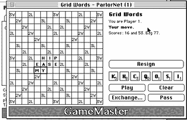

# ParlorNet rulebooks for GameMaster

## History

ParlorNet wrote seven game rulebooks for GameMaster 1.0.0 in 2026: Checkers, Mancala, Five in a Row, Grid Words, Rummy Tile, Cannon Fire and Backgammon, the last added in Install ParlorNet Rulebooks 1.4 with ParlorNet's own rulebook 0.5, whose window starts it. They are plain 68000 code, written in C and built with the Retro68 toolchain, and they draw in black and white for a Mac Plus screen. They play through ParlorNet's own rulebook, which signs you in to a parlor and carries every GameMaster game of that Mac. GameMaster itself, and its Othello, Dots&Boxes and BattleShips, are from 1991; see [GameMaster](/clients/gamemaster.html). The rulebooks are free software under the MIT license.

## Getting it

[Install ParlorNet Rulebooks](/gamemaster-rulebooks.html) puts the game rulebooks and ParlorNet's own rulebook in the folder that holds GameMaster: open it and follow its steps (Choose... picks the folder). Their source, their build and their releases are in their own repository, [eric-cgn/parlornet-gamemaster](https://github.com/eric-cgn/parlornet-gamemaster), whose GitHub Releases have the installer as BinHex, as MacBinary and on an 800K disk image for emulators and floppy writers. GameMaster 1.0.0 is not included; the GameMaster page says where to find it.

## Setting it up

Install them next to GameMaster 1.0.0, open GameMaster and choose File > New Game > ParlorNet. The Server field holds `{host}` and the Port field `6508`; sign in and start a game as the [GameMaster](/clients/gamemaster.html) page describes. They run on a Mac Plus or later with System 6.0 or later, with MacTCP or Open Transport's TCP/IP.

## Known quirks

- Grid Words, Rummy Tile, Cannon Fire and Backgammon play only on a parlor, which deals the tiles, checks the words and turns, flies the shells and rolls the dice. Checkers, Mancala and Five in a Row also play between two Macs that both have the rulebook.
- They play two players. A table for three or more is played on the web, by telnet or in ParlorNet Play.
- Backgammon draws your home board on the right; Home left (or H) draws the mirror image, and the parlor keeps that choice for your next game in GameMaster. It is kept apart from the same choice on the web and by telnet.
- A game takes up where it was left: Your games in ParlorNet's window resumes one, also a game started on the web or by telnet.

## Screenshots

