# RSCARDS (GEnie)

## History

J. Weaver Jr. of Factory Programming in Michigan wrote RSCARDS, the front end of GEnie's multiplayer games, from 1984; GEnie ran the games from about 1987 to 1995 (Backgammon, Checkers, Reversi, Chess, cards and a Waiting Room). The front end is a graphics terminal on a serial line: the host draws every screen and reads back clicks and typed lines. There were versions for the Mac, the IBM PC, the Commodore 128, the Amiga, the Atari ST and the Apple IIgs. GEnie's host program is lost; ParlorNet plays its part with screens of its own for all ten of its games ([protocols guide](../protocols.md#rscards)).

## Getting it

Each copy carries a copyright notice to J. Weaver Jr. and says it needs a GEnie account; here it needs a ParlorNet account. The Commodore 128 version draws discs in one size and colors whole 8 by 8 cells, a poor fit for these boards; on a Commodore, ParlorNet's own C64 and C128 client is the way to play. No Atari ST or Apple IIgs copy has been found.

## Setting it up

The front ends speak only over a serial port (1200 or 2400 baud, 8N1). The parlor listens on port `6520`: use a WiFi modem (`ATDT {host}:6520`, raw or telnet mode), a serial bridge, a login on a Unix machine running ATZ (`ATZ {host} 6520`, which lets the front end's stored GEnie number dial the parlor), or an emulator's modem (DOSBox: `serial1=modem`) or serial bridge (Basilisk II's modem port on a pseudo-terminal that socat connects to the parlor). [Serial connections](../serial.md) has each of these and the cable.

1. Mac: in Settings (Command-P) pick the modem port and 2400 baud, put the dial command in the dial string and press Command-D. The parlor switches RSCARDS to graphics by itself. Give the color version about 3000K in Get Info.
2. IBM PC: dial with a terminal program (in DOSBox, `echo ATDT {host}:6520 > COM1`), then run `RSCARDS 1` (the COM port).
3. Type your name in the first field and press RETURN, then your password (it does not show). A new name is offered a sign-up.
4. In the lobby, click Bot beside a game to play the bot, or Open for a table anyone can join; click a game of yours, an invitation (Yes or No), an open table to join it, or Watch beside a game being played.

A plain terminal on this port is offered the text games: press T.

The bottom line takes chat and the [shared chat commands](../chat-commands.md) (`/invite NAME` invites to the game whose name you clicked). Moves are clicked, and can be typed (`11-15`, `13-9`, `d3`, `h8`, `a1-b1`, `45 60`, `h8 a WORD`). In Grid Words click the word's first square (again for down) and type the word; in Rummy Tile Classic click rack tiles, then a set or New set; in Naval Combat click both ends of each ship or Place at random, then Ready.

In Backgammon a ring marks each place a picked checker can land, a tall stack shows five checkers and +N, and the status box says whose turn it is, the dice and what to do now. Mono versions draw black and white only; pieces carry rims, so nothing depends on color. The seat lines and the message area say what the other players play with.

Every screen is built for 2400 baud: a whole board costs 1 to 2.5 KB once, a move and the reply a few hundred bytes ([bandwidth.md](../bandwidth.md#rscards-screens) has each game's).

## Known quirks

- The Mac version holds 30 click areas, the IBM version 40, and the parlor uses at most 30: a board is a grid of columns and rows, reported together for one click. The row under the pointer shows a thin frame.
- The color Mac version shows a white window and quits on the next click at the memory it asks for (977K).
- The IBM version goes straight into graphics when started. No click sends `+++`, a modem's escape.
- Leaving graphics mode closes the line; a game is never resigned by leaving it.

## Screenshots

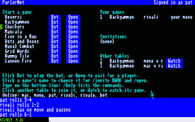
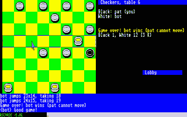
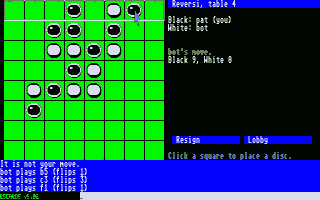
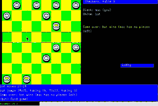
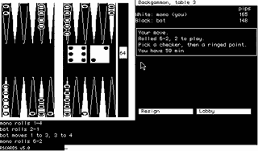
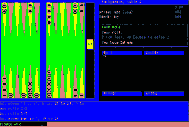
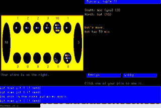
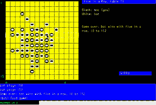
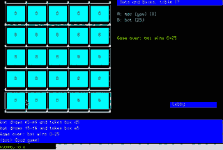
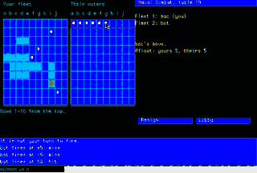
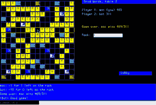
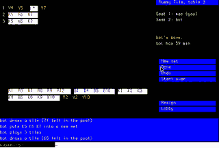
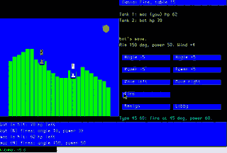
