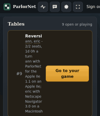
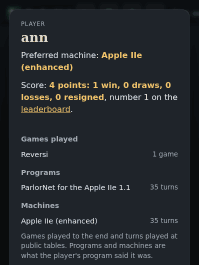

# Safari

## History

Apple's Safari 1.0 came out in 2003, and it has come with the Mac ever since.

## Getting it

Any current version works.

## Setting it up

- Open `http://{host}:6500/`. With JavaScript on, a table page updates without reloading.

## Known quirks

Nothing known yet.

## Screenshots

