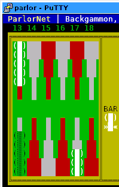
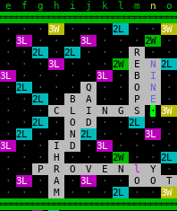

# Telnet (Windows)

## History

Windows 95 and NT came with Microsoft Telnet 1.0, a small window program. Windows 2000 and later have a console telnet instead.

## Getting it

From Windows Vista on, turn on Telnet Client in Windows Features (Turn Windows features on or off).

## Setting it up

- Type `telnet {host} 6502` in the Run box or at a command prompt.
- The console telnet takes `/t ansi` or `/t vt100` to set the terminal type.

## Known quirks

- The Windows 95 and NT program does VT100 but has no color and no line characters, so pick the `ansi` or `plain` display.
- Whether it sends the arrow keys has not been checked. If they do not move, choose the movement keys on the Telnet programs page.

## Screenshots

