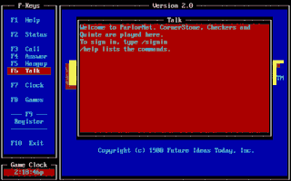
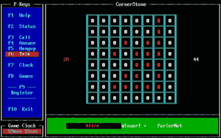
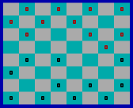
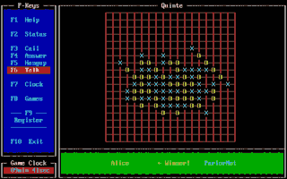

# Worthy Opponent

## History

Worthy Opponent is a pack of two-player games for the IBM PC from Future Ideas Today, Inc. of Lakewood, Colorado. Version 1.x came out in October 1988, and version 2.0, the last one found, is dated January 1990; it was US$15 shareware, and its manual lets anyone copy and give it away unchanged. Version 2.0 has twelve games: SnakePit, CornerStone (Reversi), Quinte (five in a row on a 19 by 19 grid), ArmyAnts, Checkers, Backgammon, MissileStrike, LazerMaze, CannonBall, CaveIn, TreasureQuest and MiniatureGolf. Two players play over Hayes modems at 1200 bit/s: one dials from the phone book and picks the games, the other answers, and a Talk window lets them type to each other during play. ParlorNet answers as the other copy, so the program dials the parlor as it would dial a friend ([protocols guide](../protocols.md#worthy)).

## Getting it

Take version 2.0: it is one program, `WORTHY.EXE`, with its manual, `WORTHY.DOC`. The 1.x demonstration disk lacks Quinte and Backgammon.

## Setting it up

You need a PC with a color screen (or DOSBox) and a modem that can dial a host and a port over TCP: a WiFi modem, DOSBox's emulated modem (`serial1=modem` in DOSBox, DOSBox-X or DOSBox Staging), or a serial line to a Unix login running pndial (`pndial {host} 6519`); [Serial connections](../serial.md) has the choices. Make your account on the web site or by telnet first.

1. Start `WORTHY`. In F1, Modem, choose the COM port of your modem; in F1, Name, type your ParlorNet name.
2. Press F3 for the phone book. On an empty line, move to the Name column, press Enter and type a name such as ParlorNet; then in the Number column type `ATDT {host}:6519`. A number that starts with `AT` is sent to the modem as it stands.
3. If you like more time per turn, press F8, move to the game and press F7 before you dial: the clocks of the player who dials are the ones used, at most 60 minutes in CornerStone, 12 in Checkers and 10 in Quinte.
4. In the phone book, move to the Dial column of that line and press Enter. After the modem's CONNECT the F6 line lights up: press F6 to open Talk, read the greeting, and type `/signin` and your password (or `/signin NAME PASSWORD`). Esc closes Talk.
5. Press F8 and pick CornerStone, Checkers or Quinte. The game screen comes up at once and says who moves first. Open Talk again and type `/invite bot` to play the bot.

Talk takes the [shared chat commands](../chat-commands.md):

- `/invite bot` plays the bot, and `/invite NAME` invites a player, who may be on the web, by telnet or on any other frontend.
- `/open` opens a table anyone can join, and `/join TABLE` or `/join NAME` sits you down at an open table; `/accept NAME` and `/decline NAME` answer an invitation.
- `/resign` resigns the game, after a second `/resign` to confirm; `/draw` offers or accepts a draw in Checkers, and `/nodraw` declines one.
- `/list`, `/close`, `/who`, `/note`, `/motd`, `/help` and `/quit` (which hangs up) do what they say.

Anything else you type is chat with your opponent once you have a table.

## Known quirks

- Worthy Opponent sends your name but no password, so you sign in in the Talk window. Your password shows in your own Talk window as you typed it; only the parlor receives it.
- The parlor's lines arrive in the Talk window as typed text, and the F6 line stays lit while the parlor has something to say.
- The program itself draws who moves first when you pick a game. Tables you make with `/invite` or `/open` give you that seat. At a table someone else made, the free seat may move the other way: the parlor says so, and you press F10 and pick the game again for a new draw; the seat is taken as soon as a draw fits.
- Moves you make before your opponent sits down wait at the parlor and are played when the game starts.
- Quinte's board is 19 by 19 and six in a row wins, as in the program. Checkers here has no move limit, as the program has none.
- The program's clock runs on your PC as it would against another copy. The server's own turn clock (an hour on tables made here) runs too; whichever runs out first ends your game.
- When your opponent resigns or runs out of time, the parlor says so in Talk and leaves the game, as a copy does when its player quits: the F2 line lights up, and F10 takes you back to the menu.
- Leaving a game with F10 while it runs, or hanging up, resigns it.
- Only CornerStone, Checkers and Quinte are played. Backgammon is left out because the program makes its own dice, which the server cannot share.
- A WiFi modem that treats the line as telnet should work too: the parlor reads its doubled bytes and answers its telnet questions. This was tested with a scripted line, not yet with a WiFi modem.

## Screenshots

