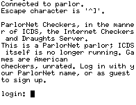
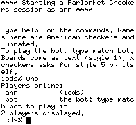
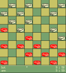
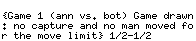

# xcheckers

## History

xcheckers is Peter Chiocchetti's checkerboard for X11. Its README is dated 17 March 2000, and 2.2.3 is the last version. It plays against Martin Fierz's engine `simplech`, which comes with it, or against people on an Internet Checkers and Draughts Server (ICDS). ICDS was Michael Rohrer's server, derived from FICS, the Free Internet Chess Server; it has long been gone. In ICDS mode xcheckers runs `telnet` to the server and shows its board, and you log in, challenge players and talk in the terminal you started it from, while the moves are made by dragging pieces on the board. Its code is partly based on xics, the X client of the Internet Chess Server. xcheckers is free software under the GNU GPL.

## Getting it

The [author's page](http://arton.cunst.net/xcheckers/) has the source, `xcheckers-2.2.3.tar.gz`. FreeBSD's ports have it as `games/xcheckers`.

To build it on a current Linux you need a C compiler, `xmkmf` (Debian's `xutils-dev`), the X11, Xext and Xpm development files and a `telnet` program. GCC 10 and later need `-fcommon`, since the program's headers define its globals: `xmkmf -a`, then `make CDEBUGFLAGS="-O2 -fcommon"`. The source needs no change.

## Setting it up

1. Start it from a terminal: `xcheckers -icds -host {host} -port 6518`, or put `xcheckers.icds: true`, `xcheckers.host: {host}` and `xcheckers.port: 6518` in `~/.xcheckersrc` and type `xcheckers`. Give the port: the build leaves it empty.
2. Log in in the terminal, at `login:` and `password:`. Typing `guest` at `login:` makes a new account.
3. Type `match bot` to play the bot, or `match NAME` to challenge a player on any frontend. `who` lists the players online. A challenge to you arrives in the terminal, and `accept NAME` or `decline NAME` answers it.
4. Drag your pieces with the left mouse button. A jump of several pieces can be dragged in one go, from its first square to its last, or a jump at a time. Ctrl-n numbers the squares and Ctrl-h hides the help window.

Other commands: `draw` offers or accepts a draw, `resign` resigns, `refresh` shows the board again, `say` talks to your opponent, `tell NAME` to a player, `games` and `observe N` watch a game, and `help` lists the rest. The shared `/` commands work too ([chat-commands.md](../chat-commands.md)), such as `/open` for a table anyone can join.

The help window's buttons send what the resource file says. The build fills them with `simplech`'s commands; for a parlor you can write your own in `~/.xcheckersrc`, for example `xcheckers.button0_label: match bot` and `xcheckers.button0_call: match bot\n`, and the same for `refresh`, `draw`, `resign` and `who`.

## Known quirks

- Your password shows in the terminal as you type it, since the terminal is xcheckers' own and telnet cannot hide it.
- The first board of a game comes as text in the terminal. xcheckers asks for the one-line board it reads by itself, and from then on the board window follows the game.
- The clock under the board holds less than ten minutes. With a longer time per turn (a day, by default) it shows 9:59 at each move and counts down from there, so it only shows whose move it is. `match NAME 5` makes a table with 5 minutes a turn, which the clock shows exactly. After the game it keeps running; that means nothing.
- The program knows no rules: a piece dropped on a wrong square stays there until the parlor's refusal makes it ask for the board again, and a captured piece leaves the screen only with the next board.
- When two lines of jumps join the same two squares, the parlor answers "Ambigous move." (spelled the way xcheckers expects); drag one jump at a time.
- The end of the game and the score are written in the terminal; the board window keeps the last position.
- Only American checkers is played here. xcheckers' international, Italian and Russian boards are not offered.

## Screenshots

