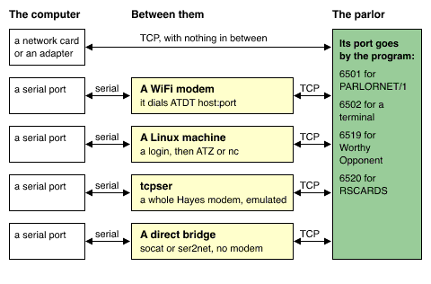

# Serial connections

Many period computers have a serial port and no network card. They can still reach a parlor, as long as whatever sits at the other end of the serial line can make a TCP connection for them. This page describes the usual ways to do that, from a WiFi modem to a login on a Linux machine, says which port each kind of program should reach, and ends with notes on the cable.



## Which port to reach

A parlor serves each kind of program on a port of its own, so the port depends on the program you run, not on how the serial line gets out.

| Program | Port |
|---|---|
| ParlorNet for the Apple IIe ([apple2.md](apple2.md)), and any program that speaks ParlorNet's own protocol, PARLORNET/1 | 6501 |
| A terminal program, for the telnet service's menus and boards | 6502 |
| Worthy Opponent ([its page](clients/worthy-opponent.md)) | 6519 |
| GEnie's RSCARDS front ends ([their page](clients/rscards.md)); a terminal that reaches it by mistake is offered the telnet service's games there | 6520 |

On the RSCARDS port, 6520, a terminal that is no RSCARDS program gets a short guide after about 12 seconds, 40 columns wide: start the RSCARDS program now, or press T for the text games, which then run on the same connection as on 6502. So a C64 or a VT100 that dialed 6520 need not dial again.

The other protocols and their ports are in [protocols.md](protocols.md). Most of them belong to programs that open TCP connections of their own, so they seldom come over a serial line.

On the native port, 6501, the parlor waits 20 seconds for the program's first line and then hangs up. A program that dials, such as ParlorNet for the Apple IIe, sends it right after CONNECT; when you make the connection by hand, start the program's side straight away.

The telnet service, 6502, opens by asking the terminal for its type and window size in telnet's own codes. A WiFi modem in telnet mode or the `telnet` program in a shell answers them. Over a plain connection, such as nc gives, they show as a few odd characters at the top of the first screen, and the parlor, which then cannot tell what the terminal is, starts in the `pc` display. Its menu shows a sample of each display, so pick the one that looks right. From a Unix shell, `telnet parlornet.org 6502` is the better way to the telnet service.

## A WiFi modem

A WiFi modem plugs into the serial port and behaves like a Hayes modem whose phone numbers are host names. Zimodem and the many other modems built on the ESP8266 or ESP32 work this way. Dial the parlor's name and port, such as `ATDT parlornet.org:6501`, and the program carries on after CONNECT as it would over a phone line.

Some of these modems can also treat the connection as telnet; on a Zimodem, the T in ATDT turns that on. The native port needs every byte passed as it is, so dial it in the modem's plain mode, which on a Zimodem is `ATD"parlornet.org:6501"`. Zimodem's telnet handling follows its register S62: with `ATS62=0` an ATDT dial is plain. Its dial command also reads letters after ATD as options, so put the host in quotes. ParlorNet's Apple II and Commodore 64 programs dial `ATDT` and the number in their settings (`ATDP` with Pulse dial on), and a number that starts with AT is sent as the whole dial command. So on a Zimodem, set the number to `ATD"parlornet.org:6501"`. Another way is the init string `ATS62=0` (or `ATS62=0&W` saved in the modem once) with the number `"parlornet.org:6501"` in quotes. Either way leave Pulse dial off: on a Zimodem, ATDP means PETSCII translation, not pulse dialing. The RSCARDS and Worthy Opponent services work either way.

## A login on a Unix machine

If the serial line runs to a Linux machine, such as a Raspberry Pi or an old PC with a USB serial adapter, and that machine offers a login on the port, the period computer's terminal program can log in to a shell there. The shell then makes the connection. On most Linux systems agetty runs the login: `agetty -L ttyUSB0 9600 vt100` answers on the first USB serial adapter at 9600 bit/s and ignores the modem control lines, and systemd's `serial-getty@ttyUSB0` service runs agetty for you. Other Unix systems have their own getty.

### By hand, with nc

Log in and type:

```
stty raw -echo; nc parlornet.org 6501; stty sane
```

`stty raw -echo` passes every byte through unchanged and stops the shell from echoing what the program sends, nc connects to the parlor, and `stty sane` puts the terminal back when the connection ends. Then start the program's side at once. On the Apple IIe, press Open-Apple-P instead of Return, as [apple2.md](apple2.md#through-a-unix-shell) explains.

The versions of nc differ in one way that matters here. The traditional nc (Debian's netcat-traditional), BusyBox's nc, GNU netcat and the nc of macOS end as soon as the parlor hangs up. OpenBSD's nc (netcat-openbsd, the usual one on Debian and Ubuntu) and Nmap's ncat do not notice the hang-up until the program sends something more: the next key or two you press ends them, and those keys go nowhere. OpenBSD nc's `-N` and `-q` options are about the end of your own input, which never comes from a terminal, so they do not change this. If it bothers you, use `busybox nc` or install the traditional nc.

### ATZ, for programs that dial

Many period programs expect a modem: they reset it with `ATZ`, send other AT commands, dial a number and wait for CONNECT. ATZ is a short Python program that plays that modem in the shell, so such a program can dial out through a Unix login with no one typing at the shell. Installed under the name ATZ on the shell's PATH, it is started by the program's own reset: the program sends `ATZ` and a carriage return to the shell prompt, the shell echoes the line, as a modem echoes a command, and runs it, and it answers OK, as the modem's reply to the reset. It is [tools/ATZ](../tools/ATZ) in ParlorNet's source, and it needs Python 3.8 or later and nothing outside Python's standard library. On Debian, Ubuntu and Raspberry Pi OS that is the `python3` package; a system with only `python3-minimal` lacks the terminal modules it uses (`termios` and `tty`). To install it in `~/.local/bin`, which most Linux systems put on the PATH of a login shell:

```
mkdir -p ~/.local/bin
curl -o ~/.local/bin/ATZ https://raw.githubusercontent.com/eric-cgn/parlornet/main/tools/ATZ
chmod +x ~/.local/bin/ATZ
```

Typed at the shell, `ATZ [host [port]]` starts it the same way. The host and port are where a dial goes when the number does not name a host itself. They default to parlornet.org and 6501, so for a program that does not speak PARLORNET/1, give the port it needs from the table above. The number dialed chooses where to go like this:

- `ATDT host:port` dials that host and port, such as `ATDT parlornet.org:6520`.
- `ATDT host` dials that host on the default port. The name must have a dot in it, such as `ATDT myparlor.example.org`.
- Any other number, such as `ATDT5551212` or `ATDT parlornet`, dials the default host and port. A program that can only dial digits, or that still holds an old phone number, works unchanged this way.

ATZ echoes the commands it is sent, as a modem does, until `ATE0` turns that off. It answers every other AT command with OK, and a line that does not start with AT gets no answer. On a dial it connects and says CONNECT with the line's speed (`CONNECT 9600`), or NO CARRIER when the host cannot be reached, and then passes every byte both ways unchanged and unechoed. When either side hangs up it says NO CARRIER and waits for the next command, as a modem would, so a program can dial again without anyone typing at the shell.

It keeps the Hayes escape, as a real modem does: a second with nothing sent, `+++`, and another second with nothing sent bring back the commands with OK while the connection stays up. Then `ATH` (or `ATZ`) hangs up, and `ATO` goes back to the connection. The seconds of quiet are what make the escape safe: a `+++` among a program's data, with bytes just before or after it, is passed on as data, so it works under any protocol. By hand at the program's terminal, wait a moment, type `+++`, wait again, then type `ATH` and Return. Control-C or Control-D at the commands ends ATZ and gives the shell back.

Some examples:

- For ParlorNet for the Apple IIe, install ATZ, log the line in to the shell once from the program's console (C), then press Open-Apple-Q for the start screen and P. The program sends ATZ, which answers OK, dials `ATDTparlornet.org:6501` (the number in its settings), and on CONNECT signs in at once, so there is no race with the parlor's 20 seconds. When you close the connection with Open-Apple-Q, the parlor hangs up, and ATZ says NO CARRIER and waits for the next dial, which P makes. Control-C in the console ends ATZ and brings back the shell prompt.
- For RSCARDS on a Mac, run `ATZ parlornet.org 6520` and leave the front end's dial string as it is. It still holds GEnie's number, which now dials the parlor. Command-D dials.
- For RSCARDS on an IBM PC, run `ATZ parlornet.org 6520`, dial from DOS with `echo ATDT5551212 > COM1`, then start `RSCARDS 1`.
- For Worthy Opponent, run `ATZ parlornet.org 6519` and dial any entry of the phone book, or put `ATDT parlornet.org:6519` in it as its page says.

It is short on purpose, and not a full modem: it has no numeric result codes, no S-registers (the escape's character and seconds are fixed) and no answering of calls. What comes from the far end while it is at the commands is dropped. For more than this, use tcpser or a WiFi modem.

## tcpser

tcpser, by Jim Brain, emulates a whole Hayes modem on a computer's serial port and dials TCP hosts. `tcpser -d /dev/ttyUSB0 -s 9600` answers on that port at 9600 bit/s, and `ATDT parlornet.org:6501` dials as on a WiFi modem. Its phone book maps a number to a parlor, so `-n5551212=parlornet.org:6520` lets a program that dials only digits reach RSCARDS. Emulators often have such a modem built in: DOSBox's `serial1=modem`, for one, dials `ATDT host:port`.

## A direct bridge

When the program does not dial at all, a bridge can join the serial port straight to the parlor's port, with no modem in between. With socat, on the machine the period computer's cable runs to:

```
socat /dev/ttyUSB0,b9600,raw,echo=0 TCP:parlornet.org:6501
```

A serial port server such as ser2net can do the same job; its own documentation covers connecting out. The bridge connects as soon as it starts, so for the native port start it just before the program connects, within the parlor's 20 seconds. ParlorNet for the Apple IIe then connects with P.

## Dialing in by phone

A parlor can also take calls from real modems over a phone line. A dial-in gateway answers each call and carries it to the parlor's dial-in extension. Dial-in access supports both telnet and the machine-specific ParlorNet clients, such as the Commodore 64 and the Apple IIe. A ParlorNet client sends PARLORNET/1 as soon as the modems connect, and it reaches the native protocol. A terminal program reaches the telnet service. After CONNECT the parlor sends nothing until you press Enter, or for 15 seconds if you don't. Then it shows its title page in plain text and echoes what you type. Sign in at the Login prompt as on telnet. A call has time limits, and the parlor tells you when 5 minutes and 1 minute are left.

## The cable

- Most computers' serial ports are wired the same way, as terminals, so a cable between two computers needs its send and receive lines crossed: a null-modem cable, or a null-modem adapter on a straight one. A modem, WiFi or not, takes a straight cable. Some serial cards, such as the Apple's Super Serial Card, have a jumper block that sets them for a modem or a terminal and so can do the crossing themselves.
- Both ends must use the same speed and format. Use 8N1: 8 data bits, no parity and 1 stop bit. 9600 or 19200 bit/s suits the Apple IIe program, RSCARDS runs at 1200 or 2400 and Worthy Opponent at 1200. On Linux the getty sets the line's speed, or `stty -F /dev/ttyUSB0 9600` for a bridge.
- For flow control use RTS/CTS, with a cable that carries those lines and both ends set for it (`stty crtscts` on Linux), or none. XON/XOFF does not survive a raw line: once the terminal is raw, as with nc, ATZ or socat, the XON and XOFF characters go to the parlor as data.
- With `agetty -L` the Linux side ignores carrier detect. Without `-L` the login waits for carrier detect, which a null-modem cable usually takes from the period computer's DTR line.
